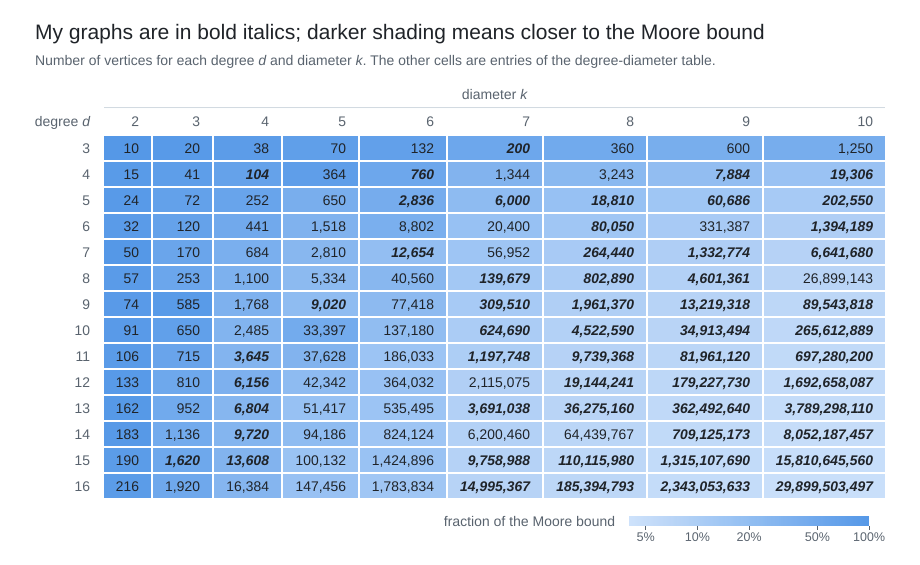
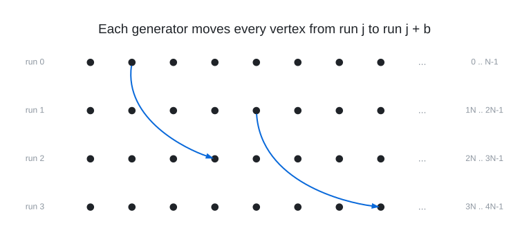

> These searches and this code were developed with Claude Fable; I set the direction, chose what to pursue and
> reviewed the results.

# Degree-Diameter Graphs

My graphs for the degree-diameter problem, which asks for the largest graph with maximum degree $`d`$ and diameter
$`k`$. The best known graphs for each pair $`(d, k)`$ are collected in the [degree-diameter table](https://web.mat.upc.edu/francesc.comellas/delta-d/taula_delta_d.html).

Every graph here has a directory `graphs/deg<d>/dia<k>/` with a README on its construction, the construction in
`construction.json`, the edge list when the graph has fewer than a million vertices, and the output of an independent
verifier in `verification.txt`.

 
Values as of 2026-10-19.

All 59 graphs and their constructions

| $`(d, k)`$ | vertices | % of Moore bound | construction |
|---|---:|---:|---|
| [(3, 7)](graphs/deg3/dia7) | 200 | 52.4% | 5-vertex lift over $`\mathbb{Z}_{5} \rtimes_{4} \mathbb{Z}_{8}`$ |
| [(3, 8)](graphs/deg3/dia8) | 360 | 47.0% | 5-vertex lift over $`\mathbb{F}_3^2 \rtimes Q_8`$ (a tie with the table's graph) |
| [(4, 4)](graphs/deg4/dia4) | 104 | 64.6% | three subdivided $`K_{4,4}`$ blocks and 32 connectors |
| [(4, 6)](graphs/deg4/dia6) | 760 | 52.2% | generalized hexagon $`H(3)`$ with 32 flags subdivided |
| [(4, 9)](graphs/deg4/dia9) | 7,884 | 20.0% | 3-vertex lift over $`\mathbb{Z}_{73} \rtimes_{18} \mathbb{Z}_{36}`$ |
| [(4, 10)](graphs/deg4/dia10) | 19,306 | 16.3% | 2-vertex lift over $`\mathbb{Z}_{197} \rtimes_{16} \mathbb{Z}_{49}`$ |
| [(5, 6)](graphs/deg5/dia6) | 2,836 | 41.5% | generalized hexagon $`H(4)`$ with 106 flags subdivided |
| [(5, 7)](graphs/deg5/dia7) | 6,000 | 22.0% | 2-vertex lift over a non-metacyclic group of order 3000 |
| [(5, 8)](graphs/deg5/dia8) | 18,810 | 17.2% | 2-vertex lift over $`\mathbb{Z}_{209} \rtimes_{4} \mathbb{Z}_{45}`$ |
| [(5, 9)](graphs/deg5/dia9) | 60,686 | 13.9% | 2-vertex lift over $`\mathbb{Z}_{1597} \rtimes_{3} \mathbb{Z}_{19}`$ |
| [(5, 10)](graphs/deg5/dia10) | 202,550 | 11.6% | 2-vertex lift over $`\mathbb{Z}_{4051} \rtimes_{4} \mathbb{Z}_{25}`$ |
| [(6, 8)](graphs/deg6/dia8) | 80,050 | 13.7% | Cayley graph of $`\mathbb{Z}_{3202} \rtimes_{1419} \mathbb{Z}_{25}`$ |
| [(6, 10)](graphs/deg6/dia10) | 1,394,189 | 9.5% | Cayley graph of $`\mathbb{Z}_{32423} \rtimes_{1693} \mathbb{Z}_{43}`$ |
| [(7, 6)](graphs/deg7/dia6) | 12,654 | 19.4% | Cayley graph of $`\mathbb{Z}_{703} \rtimes_{85} \mathbb{Z}_{18}`$ |
| [(7, 8)](graphs/deg7/dia8) | 264,440 | 11.2% | Cayley graph of $`\mathbb{Z}_{6611} \rtimes_{193} \mathbb{Z}_{40}`$ |
| [(7, 9)](graphs/deg7/dia9) | 1,332,774 | 9.4% | Cayley graph of $`\mathbb{Z}_{24681} \rtimes_{788} \mathbb{Z}_{54}`$ |
| [(7, 10)](graphs/deg7/dia10) | 6,641,680 | 7.8% | Cayley graph of $`\mathbb{Z}_{83021} \rtimes_{4400} \mathbb{Z}_{80}`$ |
| [(8, 7)](graphs/deg8/dia7) | 138,050 | 12.6% | Cayley graph of $`\mathbb{Z}_{2761} \rtimes_{63} \mathbb{Z}_{50}`$ |
| [(8, 8)](graphs/deg8/dia8) | 779,803 | 10.1% | Cayley graph of $`\mathbb{Z}_{13217} \rtimes_{8875} \mathbb{Z}_{59}`$ |
| [(8, 9)](graphs/deg8/dia9) | 4,471,111 | 8.3% | Cayley graph of $`\mathbb{Z}_{66733} \rtimes_{1441} \mathbb{Z}_{67}`$ |
| [(8, 10)](graphs/deg8/dia10) | 26,864,290 | 7.1% | Cayley graph of $`\mathbb{Z}_{141391} \rtimes_{240} \mathbb{Z}_{190}`$ |
| [(9, 5)](graphs/deg9/dia5) | 9,020 | 21.4% | Cayley graph of $`\mathbb{Z}_{451} \rtimes_{46} \mathbb{Z}_{20}`$ |
| [(9, 7)](graphs/deg9/dia7) | 302,082 | 11.2% | Cayley graph of $`\mathbb{Z}_{4577} \rtimes_{174} \mathbb{Z}_{66}`$ |
| [(9, 8)](graphs/deg9/dia8) | 1,961,370 | 9.1% | Cayley graph of $`\mathbb{Z}_{21793} \rtimes_{34} \mathbb{Z}_{90}`$ |
| [(9, 9)](graphs/deg9/dia9) | 13,219,318 | 7.7% | Cayley graph of $`\mathbb{Z}_{134891} \rtimes_{4746} \mathbb{Z}_{98}`$ |
| [(9, 10)](graphs/deg9/dia10) | 89,543,818 | 6.5% | Cayley graph of $`\mathbb{Z}_{491999} \rtimes_{477175} \mathbb{Z}_{182}`$ |
| [(10, 7)](graphs/deg10/dia7) | 616,915 | 10.3% | Cayley graph of $`\mathbb{Z}_{9491} \rtimes_{86} \mathbb{Z}_{65}`$ |
| [(10, 8)](graphs/deg10/dia8) | 4,507,500 | 8.4% | Cayley graph of $`\mathbb{Z}_{45075} \rtimes_{2} \mathbb{Z}_{100}`$ |
| [(10, 9)](graphs/deg10/dia9) | 34,182,150 | 7.1% | Cayley graph of $`\mathbb{Z}_{227881} \rtimes_{1562} \mathbb{Z}_{150}`$ |
| [(10, 10)](graphs/deg10/dia10) | 265,612,889 | 6.1% | Cayley graph of $`\mathbb{Z}_{1111351} \rtimes_{8147} \mathbb{Z}_{239}`$ |
| [(11, 4)](graphs/deg11/dia4) | 3,645 | 29.8% | the double of $`W(9)`$ with 201 vertices inserted |
| [(11, 7)](graphs/deg11/dia7) | 1,194,278 | 9.8% | Cayley graph of $`\mathbb{Z}_{20591} \rtimes_{2507} \mathbb{Z}_{58}`$ |
| [(11, 8)](graphs/deg11/dia8) | 9,739,368 | 8.0% | Cayley graph of $`\mathbb{Z}_{135269} \rtimes_{8594} \mathbb{Z}_{72}`$ |
| [(11, 9)](graphs/deg11/dia9) | 81,961,120 | 6.7% | Cayley graph of $`\mathbb{Z}_{512257} \rtimes_{706} \mathbb{Z}_{160}`$ |
| [(11, 10)](graphs/deg11/dia10) | 697,280,200 | 5.7% | Cayley graph of $`\mathbb{Z}_{3486401} \rtimes_{1834706} \mathbb{Z}_{200}`$ |
| [(12, 4)](graphs/deg12/dia4) | 6,156 | 35.0% | route-chart lift over a 76-vertex $`\mathbb{Z}_{19}`$-lift controller |
| [(12, 7)](graphs/deg12/dia7) | 2,114,927 | 9.0% | Cayley graph of $`\mathbb{Z}_{19403} \rtimes_{6308} \mathbb{Z}_{109}`$ |
| [(12, 8)](graphs/deg12/dia8) | 19,144,241 | 7.4% | Cayley graph of $`\mathbb{Z}_{90731} \rtimes_{61666} \mathbb{Z}_{211}`$ |
| [(12, 9)](graphs/deg12/dia9) | 177,775,277 | 6.3% | Cayley graph of $`\mathbb{Z}_{783151} \rtimes_{1808} \mathbb{Z}_{227}`$ |
| [(12, 10)](graphs/deg12/dia10) | 1,692,658,087 | 5.4% | Cayley graph of $`\mathbb{Z}_{3655849} \rtimes_{5568} \mathbb{Z}_{463}`$ |
| [(13, 4)](graphs/deg13/dia4) | 6,804 | 27.8% | route-chart lift over the Cayley graph of $`\mathbb{Z}_7 \rtimes_2 \mathbb{Z}_{12}`$ |
| [(13, 7)](graphs/deg13/dia7) | 3,691,038 | 8.7% | Cayley graph of $`\mathbb{Z}_{47321} \rtimes_{3981} \mathbb{Z}_{78}`$ |
| [(13, 8)](graphs/deg13/dia8) | 36,275,160 | 7.1% | Cayley graph of $`\mathbb{Z}_{302293} \rtimes_{7818} \mathbb{Z}_{120}`$ |
| [(13, 9)](graphs/deg13/dia9) | 362,492,640 | 5.9% | Cayley graph of $`\mathbb{Z}_{1258655} \rtimes_{263} \mathbb{Z}_{288}`$ |
| [(13, 10)](graphs/deg13/dia10) | 3,789,298,110 | 5.2% | Cayley graph of $`\mathbb{Z}_{9716149} \rtimes_{514348} \mathbb{Z}_{390}`$ |
| [(14, 4)](graphs/deg14/dia4) | 9,720 | 29.2% | route-chart lift over the Cayley graph of $`SL(2,3) \times \mathbb{Z}_5`$ |
| [(14, 8)](graphs/deg14/dia8) | 64,298,753 | 6.8% | Cayley graph of $`\mathbb{Z}_{185299} \rtimes_{47110} \mathbb{Z}_{347}`$ |
| [(14, 9)](graphs/deg14/dia9) | 709,125,173 | 5.7% | Cayley graph of $`\mathbb{Z}_{2104229} \rtimes_{864} \mathbb{Z}_{337}`$ |
| [(14, 10)](graphs/deg14/dia10) | 8,052,187,457 | 5.0% | Cayley graph of $`\mathbb{Z}_{10837399} \rtimes_{3457} \mathbb{Z}_{743}`$ |
| [(15, 3)](graphs/deg15/dia3) | 1,620 | 51.2% | route-chart lift over a 60-vertex $`\mathbb{Z}_{20}`$-lift controller |
| [(15, 4)](graphs/deg15/dia4) | 13,608 | 30.7% | route-chart lift over a 168-vertex $`\mathbb{Z}_{42}`$-lift controller |
| [(15, 7)](graphs/deg15/dia7) | 9,758,988 | 8.0% | Cayley graph of $`\mathbb{Z}_{90361} \rtimes_{1443} \mathbb{Z}_{108}`$ |
| [(15, 8)](graphs/deg15/dia8) | 110,115,980 | 6.5% | Cayley graph of $`\mathbb{Z}_{423523} \rtimes_{8} \mathbb{Z}_{260}`$ |
| [(15, 9)](graphs/deg15/dia9) | 1,315,107,690 | 5.5% | Cayley graph of $`\mathbb{Z}_{3372071} \rtimes_{832} \mathbb{Z}_{390}`$ |
| [(15, 10)](graphs/deg15/dia10) | 15,810,645,560 | 4.7% | Cayley graph of $`\mathbb{Z}_{20803481} \rtimes_{5726682} \mathbb{Z}_{760}`$ |
| [(16, 7)](graphs/deg16/dia7) | 14,995,367 | 7.7% | Cayley graph of $`\mathbb{Z}_{83773} \rtimes_{72211} \mathbb{Z}_{179}`$ |
| [(16, 8)](graphs/deg16/dia8) | 185,394,793 | 6.3% | Cayley graph of $`\mathbb{Z}_{769273} \rtimes_{381264} \mathbb{Z}_{241}`$ |
| [(16, 9)](graphs/deg16/dia9) | 2,343,053,633 | 5.3% | Cayley graph of $`\mathbb{Z}_{5060591} \rtimes_{949} \mathbb{Z}_{463}`$ |
| [(16, 10)](graphs/deg16/dia10) | 29,899,503,497 | 4.5% | Cayley graph of $`\mathbb{Z}_{24170981} \rtimes_{16573517} \mathbb{Z}_{1237}`$ |

## Checking the graphs

Python 3 and a C compiler are all it takes:

    python3 tools/ddgraph.py check graphs/deg5/dia8     # one graph
    python3 tools/ddgraph.py check --all                # every graph up to 10^8 vertices
    python3 tools/ddgraph.py edges graphs/deg9/dia8 > deg9-dia8.edges.txt

`check` confirms that a stored edge list is exactly its construction and runs the breadth-first-search verifiers in
`tools/verify/`: from every vertex for the smaller graphs, and from one vertex per orbit for the Cayley graphs and
voltage lifts, whose groups act transitively on the vertices or on each fibre. The largest graphs need a lot of
memory for that search, so `check` skips graphs above $`10^8`$ vertices unless `--max-vertices` is raised; their
`verification.txt` holds the output of the original run.

## Layout

- `graphs/deg<d>/dia<k>/`: one directory per graph.
- `tools/ddgraph.py`: groups, constructions, edge lists and the `check` driver (see [tools/README.md](tools/README.md)).
- `tools/verify/`: the C verifiers.
- `search/`: the code that found the graphs.

## Notation

- $`\mathbb{Z}_N \rtimes_r \mathbb{Z}_M = \langle x, y \mid x^N = y^M = 1,\ y x y^{-1} = x^r \rangle`$ is a
  metacyclic group; its element $`x^i y^j`$ is vertex $`i + N j`$ of a Cayley graph on it.
- The Cayley graph $`\mathrm{Cay}(G, S)`$ joins $`g`$ to $`g s`$ and $`g s^{-1}`$ for every $`g \in G`$ and
  $`s \in S`$.
- A voltage lift of a base graph $`B`$ over $`G`$ has vertex set $`V(B) \times G`$ and joins $`(u, g)`$ to
  $`(v, g a)`$ for every dart $`u \to v`$ of $`B`$ with voltage $`a`$.

 Vertex $`i + N j`$ is $`x^i y^j`$, so run $`j`$ is the coset $`y^j \langle x \rangle`$. A generator $`x^a y^b`$ sends $`x^i y^j`$ to $`x^{i + r^j a} y^{j + b}`$: from run $`j`$ to run $`j + b`$ (here $`b = 2`$), shifted by $`r^j a`$.
