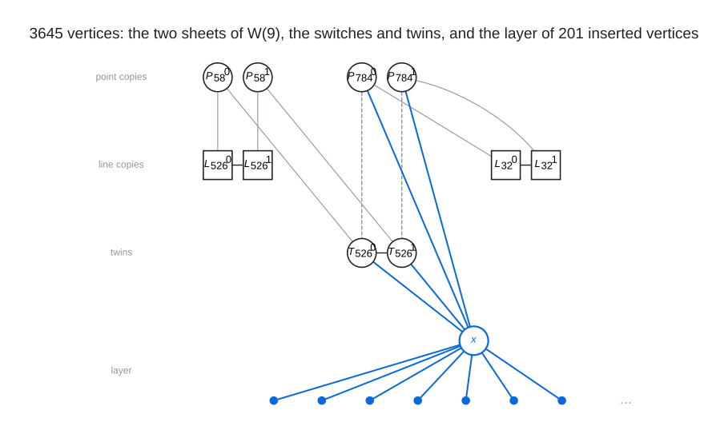

# Degree 11, Diameter 4

A graph with 3,645 vertices, maximum degree 11 and diameter 4; the Moore bound is 12,222.

## Construction

The 3444-vertex graph of this cell of the degree-diameter table, D. Yugeswardeenoo's double of the generalized quadrangle $`W(9)`$, grown by 201 insertions. $`W(9)`$ has 820 points and 820 lines, each point on 10 lines and each line through 10 points. The base graph has two copies of every point and of every line, each incidence lifted to two edges that match the copies of the point to the copies of the line (a double cover of the incidence graph), the two copies of every line joined by an edge, and 164 twins: the points are partitioned by a spread of 82 pairwise skew lines, each spread line carries two twins, each twin is joined to one copy of each of the 10 points of its line (the two twins taking complementary copies), and the two twins of a line are joined. All 3444 vertices of the base have degree 11, and the base itself has diameter 4.

An insertion deletes a few edges on which no pair at distance 4 depends, or only a few such pairs, and adds a vertex $`x`$ joined to their endpoints or to vertices next to them and to further vertices with a free slot, so that every pair whose geodesics used a deleted edge is re-routed through $`x`$ in at most 4 steps and $`x`$ reaches every vertex within 4. Every one of the 201 steps deletes the two edges at the two copies of one point $`p`$ of $`W(9)`$ (to their twins in 97 steps, to the two copies of one line in 80, one of each in 24) and joins $`x`$ to the two copies of $`p`$ and to the two vertices they lost. Both copies of a point are within 3 of every line copy and every twin, and the two twins of a spread line, like the two copies of a line, are within 3 of every point copy, so these four neighbours alone put $`x`$ within 4 of the whole base. The other neighbours of $`x`$, up to 7, are earlier inserted vertices, among them the endpoints of deleted edges between inserted vertices. The 744 deleted edges are 219 point-twin, 187 point-line, 42 line-line, 9 twin-twin, 12 at inserted vertices to twins or lines and 275 between inserted vertices; the base vertices keep degree 11, and the inserted vertices end with degree 11, except for 7 of degree 10.

 The base: the two copies of $`W(9)`$'s points (discs) and lines (squares) with the incidences lifted across the sheets, the two copies of a line joined (vertical edges), and the two twins of a spread line $`S`$, each joined to one copy of each point of $`S`$. In blue, one insertion: the two copies of the point $`p`$ lose their twin edges (dashed), and the new vertex $`x`$ is joined to them, to the two twins and to earlier inserted vertices.

Vertices $`2p`$ and $`2p + 1`$ are the two copies of point $`p`$ ($`0 \le p < 820`$), $`1640 + 2\ell`$ and $`1641 + 2\ell`$ the two copies of line $`\ell`$, $`3280 + 2s`$ and $`3281 + 2s`$ the two twins of spread line $`s`$ ($`0 \le s < 82`$), and $`3444 + k`$ the vertex added by insertion $`k`$, the insertions counted from 0 in their order.

## How it was found

201 iterated absorbed-deletion insertions into the table's 3444-vertex double of the $`W(9)`$ incidence graph (two sheets, the two copies of every line joined, 164 twins on a spread of 82 lines): a new vertex takes edges on which no distance-4 pair depends, or a few such pairs that an exact CaDiCaL completion repairs, and is joined to the two copies of a point of $`W(9)`$, to the twins or line copies they lost and to earlier inserted vertices; 67 single-edge steps (11 structured, 24 greedy, 32 SAT-assisted), 21 greedy steps allowing a few dependent pairs, then 113 steps of a selection model in which the solver chooses the deletion set and the neighbourhood together, the diameter re-checked after every step. The search code is in [search/insert_grow](../../../search/insert_grow).

## Files

- `deg11-dia4-n3645.edges.txt`: the 20,044 edges as `u v` lines, under a `#` heading per edge type.
- `insertions.txt`: the 201 insertions, one line each: the deleted edges and the neighbours of the new vertex. The subgraph on vertices 0 to 3443 with every deleted edge between them restored is the 3444-vertex base, and replaying the lines on it gives the edge list.
- `construction.json`: the construction in the form `tools/ddgraph.py` reads.
- `verification.txt`: the verifier output.

## Verification

A breadth-first search from every vertex (`tools/verify/verify_bfs.c`) confirms the order, the degrees, that there are no repeated edges, and the diameter.

    python3 tools/ddgraph.py check graphs/deg11/dia4
