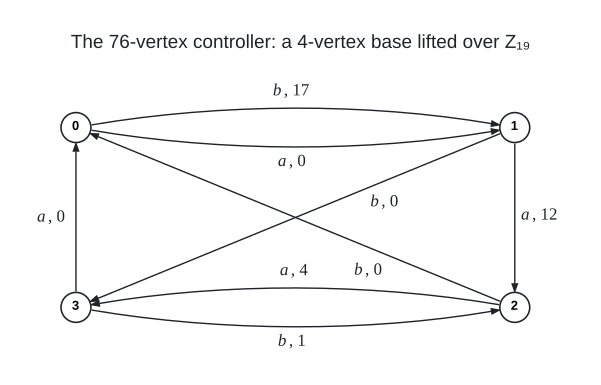

# Degree 12, Diameter 4

A graph with 6,156 vertices, maximum degree 12 and diameter 4; the Moore bound is 17,569.

## Construction

A route-chart lift: a controller graph $`C`$ on 76 vertices whose darts carry the symbols $`a`$, $`a^{-1}`$, $`b`$ and $`b^{-1}`$, a fibre $`\mathbb{F}_3^4`$ of 81 points over every controller vertex, and for every symbol a chart $`(M, d)`$, a $`4 \times 4`$ matrix over $`\mathbb{F}_3`$ and a direction. The lift has vertex set $`V(C) \times \mathbb{F}_3^4`$, and $`(v, x)`$ is joined to $`(t(v),\ M x + \lambda d)`$ for every symbol $`t`$, with the chart of $`t`$, and every $`\lambda \in \mathbb{F}_3`$: the three neighbours through $`t`$ form one line of the fibre over $`t(v)`$, so the degree is $`4 \cdot 3 = 12`$ and the order is $`76 \cdot 81 = 6156`$.

The controller is the regular $`\mathbb{Z}_{19}`$-lift of the 4-vertex Schreier base with the permutations $`\alpha_0 = (0\,1\,2\,3)`$ and $`\beta_0 = (0\,1\,3\,2)`$: its vertices are the pairs $`(c, g)`$ with $`c \in \{0, 1, 2, 3\}`$ and $`g \in \mathbb{Z}_{19}`$, the symbol $`a`$ sends $`(c, g)`$ to $`(\alpha_0(c),\ g + v_a(c))`$ with $`v_a = (0, 12, 4, 0)`$, $`b`$ sends $`(c, g)`$ to $`(\beta_0(c),\ g + v_b(c))`$ with $`v_b = (17, 0, 0, 1)`$, and $`a^{-1}`$, $`b^{-1}`$ are the inverse maps. It is 4-regular on 76 vertices and has diameter 4.

The charts, with $`M`$ acting on column vectors and the 81 points of a fibre written as $`x = (x_0, x_1, x_2, x_3)`$, are

```math
M_{a} = \begin{pmatrix} 0 & 0 & 0 & 0 \\ 0 & 1 & 1 & 0 \\ 1 & 1 & 1 & 0 \\ 1 & 1 & 0 & 0 \end{pmatrix}, \quad d_{a} = \begin{pmatrix} 1 \\ 0 \\ 0 \\ 0 \end{pmatrix}, \qquad
M_{a^{-1}} = \begin{pmatrix} 0 & 2 & 1 & 0 \\ 0 & 1 & 2 & 1 \\ 0 & 0 & 1 & 2 \\ 0 & 0 & 0 & 0 \end{pmatrix}, \quad d_{a^{-1}} = \begin{pmatrix} 0 \\ 0 \\ 0 \\ 1 \end{pmatrix},
```

```math
M_{b} = \begin{pmatrix} 2 & 1 & 0 & 0 \\ 0 & 0 & 0 & 0 \\ 1 & 0 & 0 & 1 \\ 2 & 1 & 0 & 2 \end{pmatrix}, \quad d_{b} = \begin{pmatrix} 0 \\ 1 \\ 0 \\ 0 \end{pmatrix}, \qquad
M_{b^{-1}} = \begin{pmatrix} 2 & 0 & 1 & 1 \\ 0 & 0 & 1 & 1 \\ 0 & 0 & 0 & 0 \\ 1 & 0 & 0 & 2 \end{pmatrix}, \quad d_{b^{-1}} = \begin{pmatrix} 0 \\ 0 \\ 1 \\ 0 \end{pmatrix}.
```

The charts of $`a^{-1}`$ and $`b^{-1}`$ describe the same edges as those of $`a`$ and $`b`$ read from the other end; every edge is listed once in the edge file, under the symbol that gives it.

<br><sub>Every dart $`c \to t(c)`$ of the base carries a symbol $`t`$ and a voltage $`g`$, and the controller joins $`(c, h)`$ to $`(t(c), h + g)`$ for every $`h \in \mathbb{Z}_{19}`$. The dart of the inverse symbol runs the other way with the opposite voltage.</sub>

Vertex $`81 v + x_0 + 3 x_1 + 9 x_2 + 27 x_3`$ is the pair $`(v, x)`$ with $`v = 19 c + g`$ the controller vertex $`(c, g)`$ and $`x = (x_0, x_1, x_2, x_3)`$; the fibre over $`v`$ is the run of 81 numbers from $`81 v`$.

## How it was found

Route-chart lift over $`\mathbb{F}_3^4`$ of the regular $`\mathbb{Z}_{19}`$-lift of the 4-vertex Schreier base $`\alpha_0 = (0\,1\,2\,3)`$, $`\beta_0 = (0\,1\,3\,2)`$ with voltages $`v_a = (0,12,4,0)`$, $`v_b = (17,0,0,1)`$ (76 vertices) and the four charts of the published 5832-vertex route-chart lift in this cell; the controller came from an exhaustive sweep of all voltage assignments of this base over the groups of orders 19 to 27 with the controllability word filter (72 pass over $`\mathbb{Z}_{19}`$, none over orders 20 to 27). The search code is in [search/route_chart_lifts](../../../search/route_chart_lifts).

## Files

- `deg12-dia4-n6156.edges.txt`: the 36,936 edges as `u v` lines, under a `#` heading per symbol.
- `construction.json`: the construction in the form `tools/ddgraph.py` reads.
- `verification.txt`: the verifier output.

## Verification

A breadth-first search from every vertex (`tools/verify/verify_bfs.c`) confirms the order, the degrees, that there are no repeated edges, and the diameter; the edge list is also checked against `construction.json`.

    python3 tools/ddgraph.py check graphs/deg12/dia4
