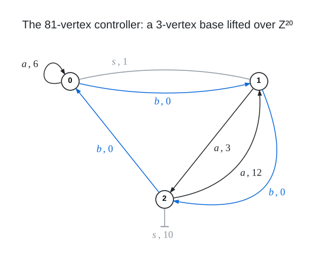

# Degree 15, Diameter 3

A graph with 1,620 vertices, maximum degree 15 and diameter 3; the Moore bound is 3,166.

## Construction

A route-chart lift: a controller graph $`C`$ on 60 vertices whose darts carry the symbols $`a`$, $`a^{-1}`$, $`b`$, $`b^{-1}`$ and $`s`$, a cell $`\mathbb{F}_3^3`$ of 27 points over every controller vertex, and for every dart a chart $`(M, d)`$, a $`3 \times 3`$ matrix over $`\mathbb{F}_3`$ and a direction. The lift has vertex set $`V(C) \times \mathbb{F}_3^3`$, and $`(v, x)`$ is joined to $`(t(v),\ M x + \lambda d)`$ for every symbol $`t`$, with the chart of $`t`$ at $`v`$, and every $`\lambda \in \mathbb{F}_3`$: the three neighbours through $`t`$ form one line of the cell over $`t(v)`$, so the degree is $`5 \cdot 3 = 15`$ and the order is $`60 \cdot 27 = 1620`$.

The controller is the regular $`\mathbb{Z}_{20}`$-lift of the 3-vertex Schreier base with the permutations $`\alpha_0 = (1\,2)`$, $`\beta_0 = (0\,1\,2)`$ and $`\sigma_0 = (0\,1)`$ (a link $`0 - 1`$ and a semi-edge at 2): its vertices are the pairs $`(c, g)`$ with $`c \in \{0, 1, 2\}`$ and $`g \in \mathbb{Z}_{20}`$, $`a`$ sends $`(c, g)`$ to $`(\alpha_0(c),\ g + v_a(c))`$ with $`v_a = (6, 3, 12)`$, $`b`$ sends it to $`(\beta_0(c),\ g)`$, and $`s`$ swaps $`(0, g)`$ with $`(1, g + 1)`$ and sends $`(2, g)`$ to $`(2, g + 10)`$, so that $`s`$ is its own inverse. It is 5-regular on 60 vertices; every vertex lies on a triangle and every two non-adjacent vertices are joined by a walk of length 3.

Each dart $`v \to w`$ carries its own matrix $`M \in GL(3, 3)`$ and direction $`d`$, and the reverse dart carries $`M^{-1}`$ and $`M^{-1} d`$; all 180 of them (the $`a`$-darts, the $`b`$-darts and the $`s`$-darts of the 60 vertices) are listed in `construction.json`. Only 12 distinct charts occur: a dart's chart is fixed by the base dart it lifts, except that the $`a`$-loops at base vertex 0 carry one chart for $`g < 14`$ and another for $`g \ge 14`$, and the semi-edges at 2 one chart for $`g < 10`$ and another for $`g \ge 10`$. The lines leaving a vertex have their directions in one pattern: the four through $`a`$, $`a^{-1}`$, $`b`$ and $`b^{-1}`$ have distinct directions that span a plane of the cell, a line of $`PG(2, 3)`$, and the direction of the line through $`s`$ lies outside that plane, so that the five directions together span the whole cell.

 Every dart $`c \to t(c)`$ of the base carries a symbol $`t`$ and a voltage $`g`$, and the controller joins $`(c, h)`$ to $`(t(c), h + g)`$ for every $`h \in \mathbb{Z}_{20}`$; the stub with a bar at 2 is the semi-edge of $`s`$, which joins $`(2, g)`$ to $`(2, g + 10)`$. The dart of the inverse symbol runs the other way with the opposite voltage.

Vertex $`27 v + x_0 + 3 x_1 + 9 x_2`$ is the pair $`(v, x)`$ with $`v = 20 c + g`$ the controller vertex $`(c, g)`$ and $`x = (x_0, x_1, x_2)`$; the cell over $`v`$ is the run of 27 numbers from $`27 v`$.

## How it was found

Route-chart lift with 27-point cells $`\mathbb{F}_3^3`$ over the 5-regular 60-vertex controller that is the regular $`\mathbb{Z}_{20}`$-lift of the 3-vertex base $`\alpha_0 = (1\,2)`$, $`\beta_0 = (0\,1\,2)`$, $`\sigma_0 = (0\,1)`$ with voltages $`v_a = (6,3,12)`$, $`v_b = (0,0,0)`$, $`v_s = 1`$ on the link and 10 on the semi-edge (the one lift class with $`A^3 + A > 0`$ found among the 3-vertex bases over the groups of orders 20 to 28); the per-dart charts are in the coplanar configuration, chosen by a type SAT and realised in $`GL(3,3)`$. The search code is in [search/route_chart_lifts](../../../search/route_chart_lifts).

## Files

- `deg15-dia3-n1620.edges.txt`: the 12,150 edges as `u v` lines, under a `#` heading per symbol.
- `construction.json`: the construction in the form `tools/ddgraph.py` reads.
- `verification.txt`: the verifier output.

## Verification

A breadth-first search from every vertex (`tools/verify/verify_bfs.c`) confirms the order, the degrees, that there are no repeated edges, and the diameter; the edge list is also checked against `construction.json`.

    python3 tools/ddgraph.py check graphs/deg15/dia3
