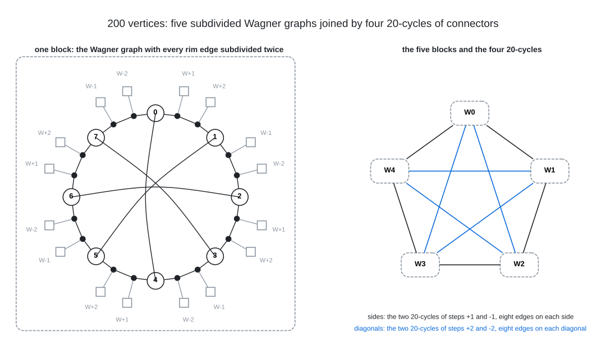

# Degree 3, Diameter 7

A graph with 200 vertices, maximum degree 3 and diameter 7; the Moore bound is 382.

## Construction

A regular voltage lift over $`G = \mathbb{Z}_{5} \rtimes_{4} \mathbb{Z}_{8} = \langle x, y \mid x^{5} = y^{8} = 1,\ y x y^{-1} = x^{4} \rangle`$, of order 40. The base graph has links $`0 \to 1`$, $`0 \to 2`$, $`0 \to 3`$ and $`1 \to 4`$ (voltage $`1`$), a link $`1 \to 2`$ (voltage $`y`$), a semi-edge at 2 (voltage $`y^{4}`$, an involution), a loop at 3 (voltage $`x y^{2}`$) and a loop at 4 (voltage $`x^{2} y^{2}`$).

The lift has vertex set $`\{0, 1, 2, 3, 4\} \times G`$ and joins $`(u, g)`$ to $`(v, g a)`$ for every dart $`u \to v`$ with voltage $`a`$; a loop with voltage $`a`$ joins $`(v, g)`$ to $`(v, g a)`$ and $`(v, g a^{-1})`$, and a semi-edge with involution $`t`$ joins $`(v, g)`$ to $`(v, g t)`$. $`G`$ acts on each fibre $`\{v\} \times G`$ by left multiplication.

 Arrows give the direction $`u \to v`$ of each voltage; a loop acts both ways, joining $`(v, g)`$ to $`(v, g a)`$ and $`(v, g a^{-1})`$. The bar marks a semi-edge: its voltage is an involution $`t`$, and it joins $`(v, g)`$ to $`(v, g t)`$.

Vertex $`40 v + i + 5 j`$ is the pair $`(v, x^i y^j)`$: each run of 40 consecutive numbers lies over one base vertex, in order, and vertex $`40 v`$ is $`(v, e)`$.

## Structure

Write $`v_{i,j}`$ for the vertex $`(v, x^i y^j)`$, with $`i \in \mathbb{Z}_5`$ and $`j \in \mathbb{Z}_8`$. The fibres of 0, 1 and 2 split into the five components $`W_0, \dots, W_4`$ indexed by $`i`$: $`W_i`$ is the Wagner graph, the 8-cycle on the hubs $`2_{i,0}, \dots, 2_{i,7}`$ with its four chords $`2_{i,j} - 2_{i,j+4}`$, with every rim edge subdivided twice, $`2_{i,j} - 0_{i,j} - 1_{i,j} - 2_{i,j+1}`$. Each block has 24 vertices, diameter 6 and girth 8; its 16 subdivision vertices are free slots: $`0_{i,j}`$ carries the connector $`3_{i,j}`$ and $`1_{i,j}`$ carries $`4_{i,j}`$.

 Left: a block $`W_i`$, its hubs numbered by $`j`$, the subdivision vertices as dots and each connector as a square tagged with the step $`s`$ of the 20-cycle through it, which joins it to the connector two hubs further round in $`W_{i+s}`$ and to the one two hubs back in $`W_{i-s}`$. Right: the sides of the pentagon carry the two 20-cycles of steps $`\pm 1`$ and the diagonals, in blue, the two of steps $`\pm 2`$, with eight connector edges on every side and every diagonal.

The 80 connectors form four 20-cycles, $`3_{i,j} - 3_{i + e(j),\, j+2}`$ and $`4_{i,j} - 4_{i + 2e(j),\, j+2}`$ with $`e(j) = (-1)^j`$: the connectors of even $`j`$ run through the blocks with step $`+1`$ (first kind) or $`+2`$ (second kind), those of odd $`j`$ with step $`-1`$ or $`-2`$, and every two blocks are joined by eight connector edges. So the graph is a complete graph $`K_5`$ of Wagner blocks, the counterpart of the three subdivided $`K_{4,4}`$ blocks of the [(4,4) graph](../../deg4/dia4). Its automorphism group is exactly the lifting group, of order 40 with the five fibres as orbits; the only simple graph it regularly covers is the 40-vertex cubic quotient by $`\langle x \rangle`$, which has one block and the four cycles closed into 4-cycles.

## How it was found

Exhaustive sweep of the voltage assignments of every 5-vertex cubic base graph (links, loops and semi-edges) over the groups of order 40; the graph is the lift of the base with edges 0-1, 0-2, 0-3, 1-4, 1-2, a semi-edge at 2 and loops at 3 and 4 over $`\mathbb{Z}_5 \rtimes \mathbb{Z}_8`$. The search code is in [search/cubic_lifts](../../../search/cubic_lifts).

## Files

- `deg3-dia7-n200.edges.txt`: the 300 edges as `u v` lines, under a `#` heading per voltage.
- `construction.json`: the construction in the form `tools/ddgraph.py` reads.
- `verification.txt`: the verifier output.

## Verification

A breadth-first search from every vertex (`tools/verify/verify_bfs.c`) confirms the order, the degrees, that there are no repeated edges, and the diameter; the edge list is also checked against `construction.json`.

    python3 tools/ddgraph.py check graphs/deg3/dia7
