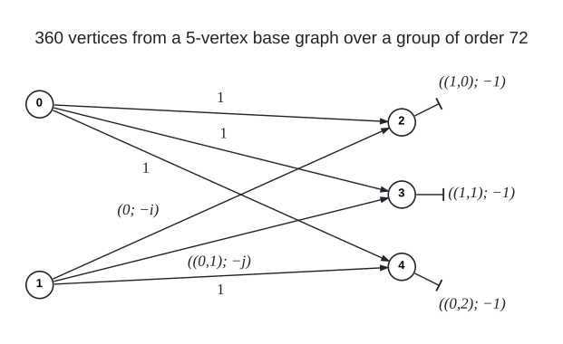
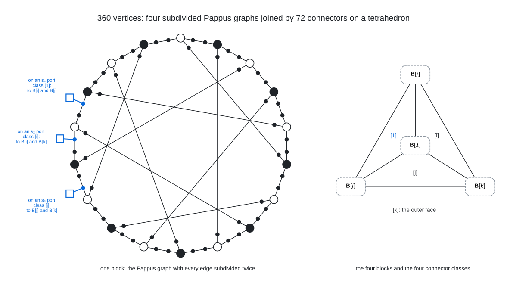

# Degree 3, Diameter 8

A graph with 360 vertices, maximum degree 3 and diameter 8; the Moore bound is 766.

The degree-diameter table lists a 360-vertex graph in this cell, found by Jianxiang Chen, and this lift is isomorphic to it: the cell is a tie, and the construction below is another description of that graph, not a new value.

## Construction

A regular voltage lift over the group $`G`$ described below, of order 72. The base graph has links $`0 \to 2`$, $`0 \to 3`$, $`0 \to 4`$ and $`1 \to 4`$ (voltage $`1`$), a link $`1 \to 2`$ (voltage $`(0;\, -i)`$), a link $`1 \to 3`$ (voltage $`((0, 1);\, -j)`$), a semi-edge at 2 (voltage $`((1, 0);\, -1)`$, an involution), a semi-edge at 3 (voltage $`((1, 1);\, -1)`$, an involution) and a semi-edge at 4 (voltage $`((0, 2);\, -1)`$, an involution).

The lift has vertex set $`\{0, 1, 2, 3, 4\} \times G`$ and joins $`(u, g)`$ to $`(v, g a)`$ for every dart $`u \to v`$ with voltage $`a`$; a loop with voltage $`a`$ joins $`(v, g)`$ to $`(v, g a)`$ and $`(v, g a^{-1})`$, and a semi-edge with involution $`t`$ joins $`(v, g)`$ to $`(v, g t)`$. $`G`$ acts on each fibre $`\{v\} \times G`$ by left multiplication.

The group is $`G = \mathbb{F}_3^2 \rtimes Q_8`$ of order 72, the affine maps $`x \mapsto q x + v`$ of the plane over $`\mathbb{F}_3`$ whose matrix $`q`$ lies in the quaternion group $`Q_8 \le \mathrm{SL}(2, 3)`$ generated by

```math
i = \begin{pmatrix} 0 & 1 \\ -1 & 0 \end{pmatrix}, \qquad j = \begin{pmatrix} 1 & 1 \\ 1 & -1 \end{pmatrix}, \qquad k = i j.
```

The element $`(v;\, q)`$ is that map, so $`(v;\, q)(w;\, r) = (v + q w;\, q r)`$; the nine involutions are the point reflections $`(v;\, -1)`$, and the translations form the normal subgroup $`\mathbb{F}_3^2`$. The semi-edge voltages are the point reflections with centres $`(1, 0)`$, $`(1, 1)`$ and $`(0, 2)`$.

<br><sub>Arrows give the direction $`u \to v`$ of each voltage; a loop acts both ways, joining $`(v, g)`$ to $`(v, g a)`$ and $`(v, g a^{-1})`$. The bar marks a semi-edge: its voltage is an involution $`t`$, and it joins $`(v, g)`$ to $`(v, g t)`$.</sub>

Vertex $`72 f + 9 h + 3 v_1 + v_2`$ is the pair $`(f, ((v_1, v_2);\, q))`$, where $`h`$ numbers the matrices $`1, i, j, k, -1, -i, -j, -k`$ from 0 to 7; the fibre over base vertex $`f`$ is the run of 72 numbers from $`72 f`$, and the vertex $`72 f`$ is the pair $`(f, e)`$.

## Structure

The lifting group is the Frobenius group $`\mathbb{F}_3^2 \rtimes Q_8`$ of order 72: the affine maps $`x \mapsto q x + v`$ of the plane over $`\mathbb{F}_3`$ whose matrix $`q`$ lies in the quaternion group $`Q_8 \le \mathrm{SL}(2,3)`$ generated by $`i = \begin{pmatrix} 0 & 1 \\ -1 & 0 \end{pmatrix}`$ and $`j = \begin{pmatrix} 1 & 1 \\ 1 & -1 \end{pmatrix}`$. Write $`(v; q)`$ for that map and $`f_{v,q}`$ for the vertex $`(f, (v; q))`$. The base graph is $`K_{2,3}`$ with a semi-edge at each of 2, 3 and 4; the links $`1 \to 2`$ and $`1 \to 3`$ carry $`(0,0; -i)`$ and $`(0,1; -j)`$, the other four links the identity, and the semi-edge at $`f`$ carries the point reflection $`(s_f; -1)`$ with centre $`s_2 = (1,0)`$, $`s_3 = (1,1)`$ or $`s_4 = (0,2)`$. The centres are not collinear, so the three reflections generate the normal subgroup $`H = \{(v; \pm 1)\}`$ of order 18, with $`G/H = Q_8/\{\pm 1\} = \{[1], [i], [j], [k]\}`$.

<br><sub>Left: the block $`B_{[1]}`$, the Pappus graph on the 18 hubs $`0_{v, \pm 1}`$ (hollow for $`q = 1`$, filled for $`q = -1`$) with every edge subdivided twice and its 54 ports as dots; the three edge types are the three translations $`s_2, s_3, s_4`$. Three of the 54 connectors are drawn as squares, in blue with their ports, one on a port of each type, tagged with the type, their class and the two other blocks they reach; every port carries one. Right: the four blocks as the vertices of a tetrahedron, each face one class of 18 connectors, labelled by the block it misses; the class $`[1]`$ is in blue, and every edge of the tetrahedron carries the 36 connectors of its two faces, 18 from each of the two faces through it.</sub>

The fibres of 0, 2, 3 and 4 split into the four components $`B_{[q]}`$, the cosets of $`H`$: $`B_{[q]}`$ has the 18 hubs $`0_{v,\pm q}`$ and the 54 ports $`f_{v,\pm q}`$, and the hub $`0_{v,q}`$ is joined through the two ports $`f_{v,q}`$ and $`f_{v + q s_f,\, -q}`$ to the hub $`0_{v + q s_f,\, -q}`$. Contracting the ports leaves the hubs $`0_{v,q}`$ adjacent to the hubs $`0_{w,-q}`$ with $`w - v \in q\{s_2, s_3, s_4\}`$, which is the Pappus graph, so each block is the Pappus graph with every edge subdivided twice: 72 vertices, girth 18, and its 54 ports as free slots. The 72 vertices of fibre 1 are connectors: $`1_{v,q}`$ meets the ports $`4_{v,q}`$, $`2_{v,-qi}`$ and $`3_{v + q(0,1),\, -qj}`$, one in each of the blocks $`B_{[q]}`$, $`B_{[qi]}`$ and $`B_{[qj]}`$, and misses $`B_{[qk]}`$. The four blocks are the vertices of a tetrahedron, the four classes of 18 connectors with the same $`[q]`$ are its faces, and every two blocks are joined by the 36 connectors of the two faces through them. The blocks are not short-diameter blocks as in the (4,4) and (3,7) graphs: two hubs at Pappus distance 3 or 4 are 7 or 8 apart in the graph, through connectors.

The graph has girth 13, so the ball of radius 6 around every vertex is the full Moore tree on 190 vertices. Its automorphism group is $`\mathrm{ASL}(2,3) = \mathbb{F}_3^2 \rtimes \mathrm{SL}(2,3)`$ of order 216, three times the lifting group: the extra symmetries permute the three port fibres cyclically, the hubs, the connectors and the 216 ports are the three orbits, the four blocks are permuted as the rotation group $`A_4`$ of the tetrahedron, and the action on the ports is regular, so the ports are the elements of $`\mathrm{ASL}(2,3)`$, the hubs and connectors are the cosets of two subgroups of order 3, and the port matching is right multiplication by one point reflection. It regularly covers two simple graphs, the 40-vertex cubic graph of girth 6 obtained by collapsing the translations, in which every Pappus block becomes two hubs joined by three paths of length 3, and a 120-vertex graph obtained from one $`\mathbb{Z}_3`$ of translations; it is a 2-fold cover of nothing, and it covers neither $`K_4`$ nor any cubic graph on 6, 8 or 10 vertices, the dodecahedron or, being non-bipartite, any bipartite graph such as the Pappus graph itself. The four voltage assignments that the search finds on this base and group give one and the same graph up to isomorphism.

## How it was found

Exhaustive sweep of the voltage assignments of every 5-vertex cubic base graph over the groups of order 72 (one representative per orbit of the group's automorphisms); the graph is the lift of $`K_{2,3}`$ with a semi-edge at each vertex of its larger side over $`\mathbb{F}_3^2 \rtimes Q_8`$, the four solutions of that base and group being one and the same graph up to isomorphism. The search code is in [search/cubic_lifts](../../../search/cubic_lifts).

## Files

- `deg3-dia8-n360.edges.txt`: the 540 edges as `u v` lines, under a `#` heading per voltage.
- `construction.json`: the construction in the form `tools/ddgraph.py` reads.
- `verification.txt`: the verifier output.

## Verification

A breadth-first search from every vertex (`tools/verify/verify_bfs.c`) confirms the order, the degrees, that there are no repeated edges, and the diameter; the edge list is also checked against `construction.json`.

    python3 tools/ddgraph.py check graphs/deg3/dia8
