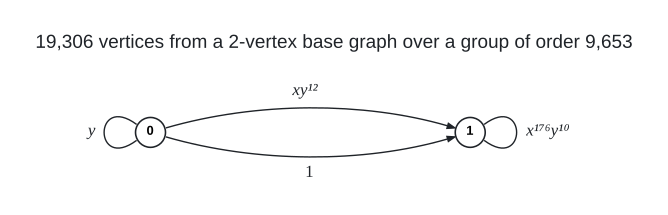

# Degree 4, Diameter 10

A graph with 19,306 vertices, maximum degree 4 and diameter 10; the Moore bound is 118,097.

## Construction

A regular voltage lift over $`G = \mathbb{Z}_{197} \rtimes_{16} \mathbb{Z}_{49} = \langle x, y \mid x^{197} = y^{49} = 1,\ y x y^{-1} = x^{16} \rangle`$, of order 9,653. The base graph has two parallel links $`0 \to 1`$ (voltages $`1`$, $`x y^{12}`$), a loop at 0 (voltage $`y`$) and a loop at 1 (voltage $`x^{176} y^{10}`$).

The lift has vertex set $`\{0, 1\} \times G`$ and joins $`(u, g)`$ to $`(v, g a)`$ for every dart $`u \to v`$ with voltage $`a`$; a loop with voltage $`a`$ joins $`(v, g)`$ to $`(v, g a)`$ and $`(v, g a^{-1})`$. $`G`$ acts on each fibre $`\{v\} \times G`$ by left multiplication.

 Arrows give the direction $`u \to v`$ of each voltage; a loop acts both ways, joining $`(v, g)`$ to $`(v, g a)`$ and $`(v, g a^{-1})`$.

Vertex $`9653 v + i + 197 j`$ is the pair $`(v, x^i y^j)`$: the first 9,653 vertices lie over base vertex 0 and the other 9,653 over base vertex 1, and vertex $`9653 v`$ is $`(v, e)`$.

## How it was found

Fully symmetry-reduced exhaustive sweep of the 2-vertex base with a loop at each vertex and two parallel links over odd-order metacyclic groups $`\mathbb{Z}_N \rtimes_r \mathbb{Z}_M`$; the graph lives over $`\mathbb{Z}_{197} \rtimes_{16} \mathbb{Z}_{49}`$, where five inequivalent assignments reach diameter 10. The search code is in [search/lift_two_vertex](../../../search/lift_two_vertex).

## Files

- `deg4-dia10-n19306.edges.txt`: the 38,612 edges as `u v` lines, under a `#` heading per voltage.
- `construction.json`: the construction in the form `tools/ddgraph.py` reads.
- `verification.txt`: the verifier output.

## Verification

A breadth-first search from every vertex (`tools/verify/verify_bfs.c`) confirms the order, the degrees, that there are no repeated edges, and the diameter; the edge list is also checked against `construction.json`.

    python3 tools/ddgraph.py check graphs/deg4/dia10
