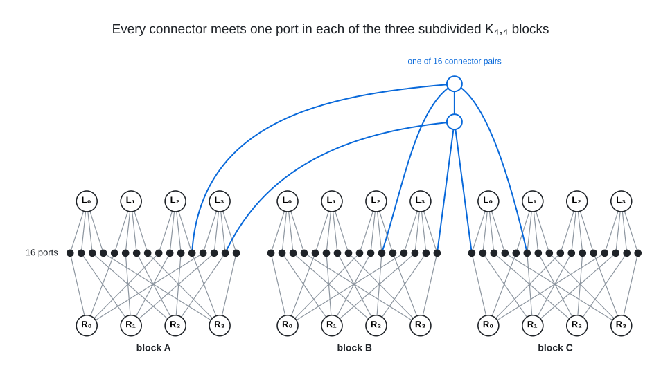

# Degree 4, Diameter 4

A graph with 104 vertices, maximum degree 4 and diameter 4; the Moore bound is 161.

## Construction

Three disjoint copies (blocks A, B and C) of the subdivided complete bipartite graph $`K_{4,4}`$, and 32 connector vertices in 16 matched pairs. In a block, each of the hubs $`L_0, \dots, L_3`$ and $`R_0, \dots, R_3`$ meets four ports, and port $`P_{xy}`$ subdivides $`L_x R_y`$. Every port also meets two connectors; every connector meets its partner and three ports.

 Left: block A as the grid of $`K_{4,4}`$: port $`P_{xy}`$ is the dot in row $`x`$ and column $`y`$, and its two connectors hang from it as squares, named $`ka`$ and $`kb`$ for the connectors $`72 + 2k`$ and $`73 + 2k`$ of pair $`k`$. In blue, pair 15 on the twin ports $`P_{32}`$ and $`P_{23}`$, its connectors tagged with the ports they meet in blocks B and C; every pair meets twin ports $`P_{xy}`$ and $`P_{x \oplus 1, y \oplus 1}`$ ($`\oplus`$ is bitwise exclusive or) in every block. Right: the three blocks and the 16 connector pairs, pair 15 in the middle with its six edges into the blocks, each named by the port it reaches, and the other 15 pairs as their partner edges.

Block A is vertices 0 to 23 ($`L_0, \dots, L_3`$ are 0 to 3, $`R_0, \dots, R_3`$ are 4 to 7, and port $`P_{xy}`$ is $`8 + 4x + y`$), block B is 24 to 47 and block C is 48 to 71 in the same pattern, and connector pair $`k`$ ($`0 \le k \le 15`$) is $`72 + 2k`$ and $`73 + 2k`$.

## Structure

This graph is class 29 of the 36 degree-4, diameter-4 graphs on 104 vertices built from three subdivided $`K_{4,4}`$ blocks with no port-port edge, one of the two classes with an automorphism group of order 32. It is one of the two pure templates: every connector meets one port in each block, so the figure is the whole construction; in each of the other 34 classes two or three connector pairs meet two ports of one block and none of another. All 36 are in [search/deg4-dia4/classes](../../../search/deg4-dia4/classes), and [search/deg4-dia4](../../../search/deg4-dia4) proves that this architecture admits no graph on 105 to 108 vertices.

The automorphism group has seven orbits on the vertices: the 32 connectors, the 16 ports of block B, the 4 hubs on each side of block B, the 16 hubs of blocks A and C, and two orbits of 16 ports of blocks A and C; every automorphism fixes block B, and the group exchanges blocks A and C.

## How it was found

Symmetric $`\mathbb{Z}_8`$ voltage lift over a 13-vertex base pregraph with defect-targeted moves and basin hopping until the lift stalls at a small defect, then symmetry-breaking 2-opt edge repair closes the last pairs; the 36 isomorphism classes come from enumerating every diameter-4 realisation (SAT) of the three tight three-block skeletons that admit one and sorting them by canonical form. The search code is in [search/deg4-dia4](../../../search/deg4-dia4).

## Files

- `deg4-dia4-n104.edges.txt`: the 208 edges as `u v` lines, under a `#` heading per edge type.
- `construction.json`: the construction in the form `tools/ddgraph.py` reads.
- `verification.txt`: the verifier output.

## Verification

A breadth-first search from every vertex (`tools/verify/verify_bfs.c`) confirms the order, the degrees, that there are no repeated edges, and the diameter.

    python3 tools/ddgraph.py check graphs/deg4/dia4
