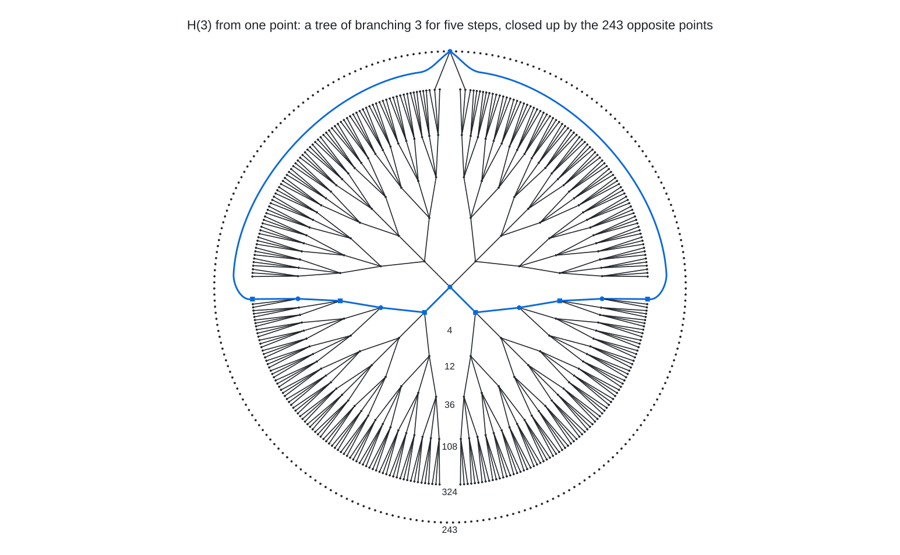
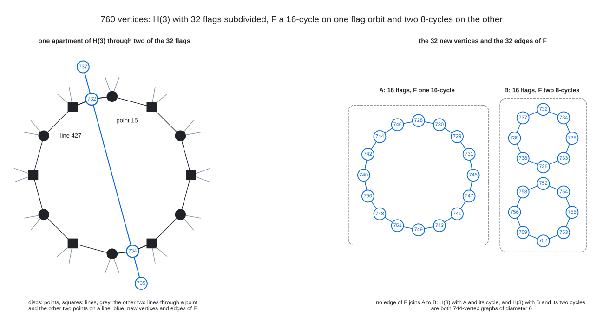
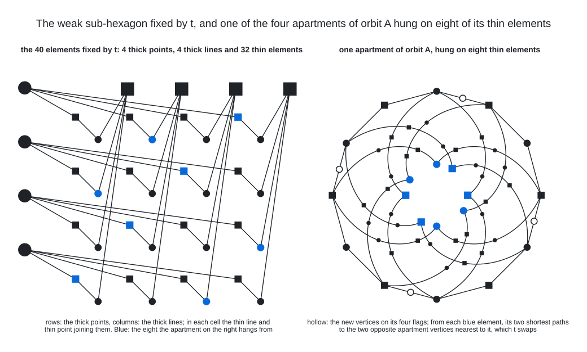

# Degree 4, Diameter 6

A graph with 760 vertices, maximum degree 4 and diameter 6; the Moore bound is 1,457.

## Construction

The generalized hexagon $`H(3)`$ is a point-line geometry with 364 points and 364 lines: every line carries 4 points, every point lies on 4 lines, two points share at most one line, and the shortest closed chains of incidences are ordinary hexagons, 6 points and 6 lines around a cycle, with no triangles, quadrilaterals or pentagons. Any two elements, points or lines, lie on a common hexagon, called an apartment. Concretely, the points are the 364 points of the parabolic quadric $`Q(6, 3)`$ in $`\mathrm{PG}(6, 3)`$ and the lines are 364 of its lines (the split Cayley hexagon); $`H(3)`$ is self-dual, so points and lines play the same role.

Its incidence graph, one vertex per point and per line and one edge per incidence, is 4-regular and bipartite on 728 vertices with girth 12 and diameter 6. From any vertex the 485 vertices within distance 5 form a tree, each reached by a unique shortest path, and each of the remaining 243 vertices, the opposite ones, is at distance exactly 6 along 4 shortest paths. A bipartite graph of degree 4 and diameter 6 has at most $`2\,(1 + 3 + 9 + 27 + 81 + 243) = 728`$ vertices, the graphs that attain this bound are exactly the incidence graphs of generalized hexagons of order $`(3, 3)`$, and $`H(3)`$ is the only one known. So it is the natural core for this cell: every vertex already has degree 4 and every pair is already within distance 6, with nothing to spare.

The graph is this incidence graph with 32 flags subdivided: a new vertex $`w`$ is placed on each of 32 point-line incidence edges $`(p, L)`$ and joined to that point and that line, and the 32 new vertices carry a 2-regular graph $`F`$ with cycles of lengths 8, 8 and 16. Subdividing a flag costs nothing locally, $`p`$ and $`L`$ keep degree 4 and $`w`$ gets 2 of its 4 edges, but every path through it is one step longer. Note that one subdivided flag separates no two old vertices beyond 6, since opposite vertices have 4 shortest paths and every other pair is within 5; the new vertex $`w`$, however, is at distance 6 from the 486 vertices at distance 5 from $`p`$ or from $`L`$ on the far side, by one shortest path each, and a second subdivided flag on such a path pushes that pair to 7. So the 32 flags must be chosen to do little such damage to one another, and the 2 remaining edges of every new vertex, the graph $`F`$, must repair all of it: an edge of $`F`$ joins two new vertices that are otherwise 6 to 8 apart, a shortcut for them and for everything near them.

Vertices 0 to 363 are the points of $`H(3)`$, 364 to 727 its lines and 728 to 759 the 32 new vertices.

## Structure

 The incidence graph of $`H(3)`$ seen from the point 15: the tree of its 4 lines, their 12 further points, 36 lines, 108 points and 324 lines, and the ring of the 243 points opposite it, each joined to 4 of the 324 lines, one in each quarter. The opposite point 201 at the top is drawn with its 4 edges; any two of its 4 shortest paths to the centre close up into an apartment, and the blue one is the apartment through the flags of the new vertices 732 and 734, 7 apart round it either way and joined by an edge of $`F`$.

 Left: an apartment of $`H(3)`$, the 12-cycle of its incidence graph through the flags of the new vertices 732 and 734, opposite in it. Without $`F`$ the two are 7 apart round either side; the blue edge of $`F`$ between them is the shortcut, and their other edges of $`F`$ lead to 737 and 735. Right: the 32 new vertices, numbered as in the edge list, with the 32 edges of $`F`$: a 16-cycle on the orbit $`A`$ and two 8-cycles on the orbit $`B`$, and no edge between the orbits.

The 32 flags form two 16-flag orbits $`A`$ and $`B`$ of a Sylow 2-subgroup (order 128) of $`\mathrm{Aut}(H(3)) = G_2(3){:}2`$ in the centraliser of an involution. $`F`$ has no edge between the orbits, so the graph is two 744-vertex solutions glued along $`H(3)`$. The 32 flags are pairwise non-incident, no point of one on a line of another, and every edge of $`F`$ joins two flags whose points are opposite in $`H(3)`$, at distance 6. The automorphism group of the graph is trivial.

The involution $`t`$ at the centre of that Sylow 2-subgroup fixes 20 points and 20 lines of $`H(3)`$, a weak sub-hexagon: 4 thick points and 4 thick lines, each incident with 4 fixed elements, and 32 thin ones, each incident with 2, so that the fixed structure is $`K_{4,4}`$ on the thick elements with each of its 16 edges subdivided twice. No flag of $`A`$ or $`B`$ touches it. The 16 points and 16 lines of $`A`$ are at distance 3 from it, every point from 2 thin lines and every line from 2 thin points, and those of $`B`$ at distance 4, every point from 4 thin points, one on each thick line, and every line from 4 thin lines, one through each thick point. $`A`$ is every third flag of 4 apartments that $`t`$ turns half round, each hung on 8 of the thin elements and the 4 together on all 32; the two 8-cycles of $`F`$ on $`B`$ run through two sets of 8 pairwise opposite flags. $`t`$ carries every flag to an opposite flag, pairing the 32 into 16 pairs, and the 16 edges of $`F`$ within those pairs are every second edge of each of its 3 cycles.

 Left: the 40 elements fixed by $`t`$, the 4 thick points as rows and the 4 thick lines as columns, with the thin line and the thin point that join a row to a column in their cell: $`K_{4,4}`$ with every edge subdivided twice, 48 incidences in all. Right: the apartment of $`A`$ through the flags of 728, 730, 749 and 751 with the 8 thin elements at distance 3 from it, blue in both panels, 4 thin lines and 4 thin points that each take one cell per row and per column. From each of the 8 its two shortest paths lead to the two opposite vertices of the apartment nearest to it, and $`t`$, the half turn of the apartment, swaps the two paths.

## How it was found

Incidence graph of the generalized hexagon $`H(3)`$ (728 vertices) with 32 flags subdivided and a 2-regular graph on the new vertices; the flag set is the union of two 16-flag orbits of a Sylow 2-subgroup of the centraliser of an involution of $`G_2(3)`$, and the 2-factor is found by exact-cost simulated annealing with the flag set fixed. The search code is in [search/hexagon_insertion](../../../search/hexagon_insertion).

## Files

- `deg4-dia6-n760.edges.txt`: the 1,520 edges as `u v` lines, under a `#` heading per edge type.
- `construction.json`: the construction in the form `tools/ddgraph.py` reads.
- `verification.txt`: the verifier output.

## Verification

A breadth-first search from every vertex (`tools/verify/verify_bfs.c`) confirms the order, the degrees, that there are no repeated edges, and the diameter.

    python3 tools/ddgraph.py check graphs/deg4/dia6
