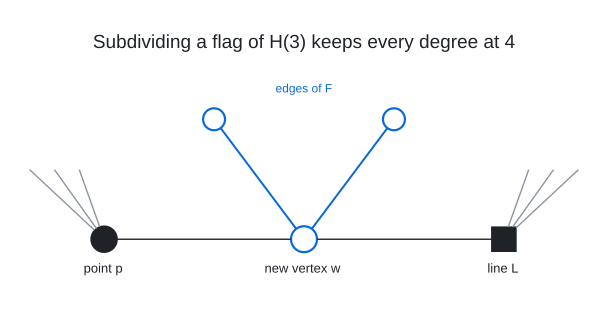

# Degree 4, Diameter 6

A graph with 760 vertices, maximum degree 4 and diameter 6; the Moore bound is 1,457.

## Construction

The generalized hexagon $`H(3)`$ is a point-line geometry with 364 points and 364 lines: every line carries 4 points, every point lies on 4 lines, two points share at most one line, and the shortest closed chains of incidences are ordinary hexagons, 6 points and 6 lines around a cycle, with no triangles, quadrilaterals or pentagons. Any two elements, points or lines, lie on a common hexagon, called an apartment. Concretely, the points are the 364 points of the parabolic quadric $`Q(6, 3)`$ in $`\mathrm{PG}(6, 3)`$ and the lines are 364 of its lines (the split Cayley hexagon); $`H(3)`$ is self-dual, so points and lines play the same role.

Its incidence graph, one vertex per point and per line and one edge per incidence, is 4-regular and bipartite on 728 vertices with girth 12 and diameter 6. From any vertex the 485 vertices within distance 5 form a tree, each reached by a unique shortest path, and each of the remaining 243 vertices, the opposite ones, is at distance exactly 6 along 4 shortest paths. A bipartite graph of degree 4 and diameter 6 has at most $`2\,(1 + 3 + 9 + 27 + 81 + 243) = 728`$ vertices, the graphs that attain this bound are exactly the incidence graphs of generalized hexagons of order $`(3, 3)`$, and $`H(3)`$ is the only one known. So it is the natural core for this cell: every vertex already has degree 4 and every pair is already within distance 6, with nothing to spare.

The graph is this incidence graph with 32 flags subdivided: a new vertex $`w`$ is placed on each of 32 point-line incidence edges $`(p, L)`$ and joined to that point and that line, and the 32 new vertices carry a 2-regular graph $`F`$ with cycles of lengths 8, 8 and 16. Subdividing a flag costs nothing locally, $`p`$ and $`L`$ keep degree 4 and $`w`$ gets 2 of its 4 edges, but every path through it is one step longer. Note that one subdivided flag separates no two old vertices beyond 6, since opposite vertices have 4 shortest paths and every other pair is within 5; the new vertex $`w`$, however, is at distance 6 from the 486 vertices at distance 5 from $`p`$ or from $`L`$ on the far side, by one shortest path each, and a second subdivided flag on such a path pushes that pair to 7. So the 32 flags must be chosen to do little such damage to one another, and the 2 remaining edges of every new vertex, the graph $`F`$, must repair all of it: an edge of $`F`$ joins two new vertices that are otherwise 6 to 8 apart, a shortcut for them and for everything near them.

 The flag $`(p, L)`$ of $`H(3)`$ (point: disc, line: square, grey: their other incidences) becomes the path $`p - w - L`$, and the new vertex $`w`$ also meets its neighbours in $`F`$ (blue). So $`w`$ has degree $`2 + 2 = 4`$, and $`p`$ and $`L`$ keep degree 4.

Vertices 0 to 363 are the points of $`H(3)`$, 364 to 727 its lines and 728 to 759 the 32 new vertices.

## Structure

The 32 flags form two 16-flag orbits $`A`$ and $`B`$ of a Sylow 2-subgroup (order 128) of $`\mathrm{Aut}(H(3)) = G_2(3){:}2`$ in the centraliser of an involution. $`F`$ has no edge between the orbits, so the graph is two 744-vertex solutions glued together along $`H(3)`$. The 32 flags are pairwise non-incident, and every edge of $`F`$ joins two flags whose points are opposite in $`H(3)`$, that is, at distance 6. The automorphism group of the graph is trivial.

 Left: an apartment of $`H(3)`$, the 12-cycle of its incidence graph through the flags of the new vertices 732 and 734, opposite in it. Without $`F`$ the two are 7 apart round either side; the blue edge of $`F`$ between them is the shortcut, and their other edges of $`F`$ lead to 737 and 735. Right: the 32 new vertices, numbered as in the edge list, with the 32 edges of $`F`$: a 16-cycle on the orbit $`A`$ and two 8-cycles on the orbit $`B`$, and no edge between the orbits.

## How it was found

Incidence graph of the generalized hexagon $`H(3)`$ (728 vertices) with 32 flags subdivided and a 2-regular graph on the new vertices; the flag set is the union of two 16-flag orbits of a Sylow 2-subgroup of the centraliser of an involution of $`G_2(3)`$, and the 2-factor is found by exact-cost simulated annealing with the flag set fixed. The search code is in [search/hexagon_insertion](../../../search/hexagon_insertion).

## Files

- `deg4-dia6-n760.edges.txt`: the 1,520 edges as `u v` lines, under a `#` heading per edge type.
- `construction.json`: the construction in the form `tools/ddgraph.py` reads.
- `verification.txt`: the verifier output.

## Verification

A breadth-first search from every vertex (`tools/verify/verify_bfs.c`) confirms the order, the degrees, that there are no repeated edges, and the diameter.

    python3 tools/ddgraph.py check graphs/deg4/dia6
