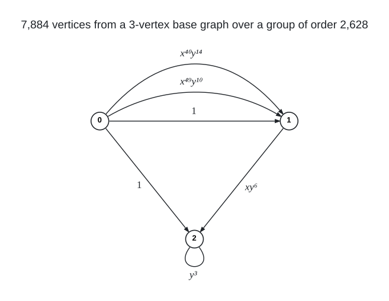

# Degree 4, Diameter 9

A graph with 7,884 vertices, maximum degree 4 and diameter 9; the Moore bound is 39,365.

## Construction

A regular voltage lift over $`G = \mathbb{Z}_{73} \rtimes_{18} \mathbb{Z}_{36} = \langle x, y \mid x^{73} = y^{36} = 1,\ y x y^{-1} = x^{18} \rangle`$, of order 2,628. The base graph has three parallel links $`0 \to 1`$ (voltages $`1`$, $`x^{49} y^{10}`$, $`x^{40} y^{14}`$), a link $`0 \to 2`$ (voltage $`1`$), a link $`1 \to 2`$ (voltage $`x y^{6}`$) and a loop at 2 (voltage $`y^{3}`$).

The lift has vertex set $`\{0, 1, 2\} \times G`$ and joins $`(u, g)`$ to $`(v, g a)`$ for every dart $`u \to v`$ with voltage $`a`$; a loop with voltage $`a`$ joins $`(v, g)`$ to $`(v, g a)`$ and $`(v, g a^{-1})`$. $`G`$ acts on each fibre $`\{v\} \times G`$ by left multiplication.

 Arrows give the direction $`u \to v`$ of each voltage; a loop acts both ways, joining $`(v, g)`$ to $`(v, g a)`$ and $`(v, g a^{-1})`$.

Vertex $`2628 v + i + 73 j`$ is the pair $`(v, x^i y^j)`$: each run of 2,628 consecutive numbers lies over one base vertex, in order, and vertex $`2628 v`$ is $`(v, e)`$.

## Structure

The automorphism group is the lifting group $`G`$ itself, of order 2,628, acting regularly on each of the three fibres, which are its orbits, so the graph is not vertex-transitive.

## How it was found

Complete symmetry-reduced sweep of all voltage assignments of the 3-vertex base with a triple link, a path and a loop over the one-involution metacyclic group $`\mathbb{Z}_{73} \rtimes_{18} \mathbb{Z}_{36}`$. The search code is in [search/lift_three_vertex](../../../search/lift_three_vertex).

## Files

- `deg4-dia9-n7884.edges.txt`: the 15,768 edges as `u v` lines, under a `#` heading per voltage.
- `construction.json`: the construction in the form `tools/ddgraph.py` reads.
- `verification.txt`: the verifier output.

## Verification

A breadth-first search from every vertex (`tools/verify/verify_bfs.c`) confirms the order, the degrees, that there are no repeated edges, and the diameter; the edge list is also checked against `construction.json`.

    python3 tools/ddgraph.py check graphs/deg4/dia9
