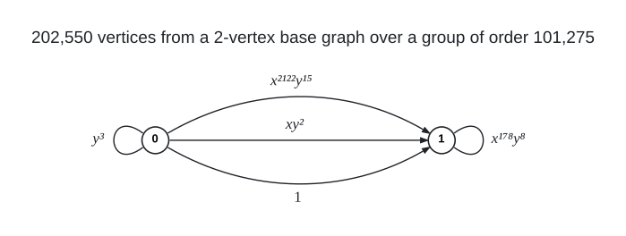

# Degree 5, Diameter 10

A graph with 202,550 vertices, maximum degree 5 and diameter 10. The Moore bound for degree 5 and diameter 10 is 1,747,626.

## Construction

A regular voltage lift over $`G = \mathbb{Z}_{4051} \rtimes_{4} \mathbb{Z}_{25} = \langle x, y \mid x^{4051} = y^{25} = 1,\ y x y^{-1} = x^{4} \rangle`$, of order 101,275. The base graph has vertices 0 and 1, with three parallel links $`0 \to 1`$ (voltages $`1`$, $`x y^{2}`$, $`x^{2122} y^{15}`$), a loop at 0 (voltage $`y^{3}`$) and a loop at 1 (voltage $`x^{178} y^{8}`$).

The lift has vertex set $`\{0, 1\} \times G`$ and joins $`(u, g)`$ to $`(v, g a)`$ for every dart $`u \to v`$ with voltage $`a`$; a loop with voltage $`a`$ joins $`(v, g)`$ to $`(v, g a)`$ and $`(v, g a^{-1})`$. $`G`$ acts on each fibre $`\{v\} \times G`$ by left multiplication.

 Arrows give the direction $`u \to v`$ of each voltage; a loop acts both ways, joining $`(v, g)`$ to $`(v, g a)`$ and $`(v, g a^{-1})`$.

Vertex $`101275 v + i + 4051 j`$ is the pair $`(v, x^i y^j)`$: the first 101,275 vertices lie over base vertex 0 and the other 101,275 over base vertex 1, and vertex $`101275 v`$ is $`(v, e)`$.

## How it was found

Complete sweep of the level-pattern block (3, 8, 2, 15) of the shape-103 two-vertex lift family over the odd-order group $`\mathbb{Z}_{4051} \rtimes_4 \mathbb{Z}_{25}`$ after a pattern screen. The search code is in [search/lift_two_vertex](../../../search/lift_two_vertex).

## Files

- `deg5-dia10-n202550.edges.txt.gz`: the 506,375 edges (gzipped), one `u v` per line in the numbering above, grouped by voltage under `#` headings.
- `construction.json`: the construction in the form `tools/ddgraph.py` reads.
- `verification.txt`: the verifier output.

## Verification

The edge list is checked to be exactly the construction in `construction.json`. $`G`$ acts transitively on each fibre, so the eccentricities of $`(0, e)`$ and $`(1, e)`$ give the diameter: a breadth-first search over the graph defined by `construction.json` decides it.

    python3 tools/ddgraph.py check graphs/deg5/dia10
