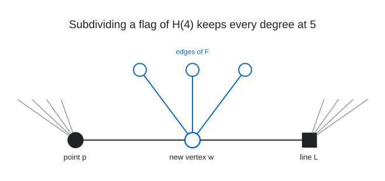

# Degree 5, Diameter 6

A graph with 2,836 vertices, maximum degree 5 and diameter 6. The Moore bound for degree 5 and diameter 6 is 6,826.

## Construction

The incidence graph of the generalized hexagon $`H(4)`$ (1365 points and 1365 lines; 5-regular, bipartite, girth 12, diameter 6) with 106 flags subdivided and a cubic graph $`F`$ on the 106 new vertices.

$`F`$ was built first, minimising its number of vertex pairs at distance 6 (881 in the end; $`F`$ has diameter 6), and the 106 flags were then placed with $`F`$ fixed.

The flag $`(p, L)`$ of $`H(4)`$ (point: disc, line: square, gray: their other incidences) becomes the path $`p - w - L`$, and the new vertex $`w`$ also meets its neighbours in $`F`$ (blue). So $`w`$ has degree $`2 + 3 = 5`$, and $`p`$ and $`L`$ keep degree 5.

Vertices 0 to 1364 are the points of $`H(4)`$, 1365 to 2729 its lines and 2730 to 2835 the 106 new vertices.

## How it was found

Incidence graph of the generalized hexagon $`H(4)`$ (2730 vertices) with 106 flags subdivided and a cubic graph $`F`$ on the new vertices: $`F`$ is built first by simulated annealing on half-edge switches minimising its exact number of pairs at distance 6 or more, then the flag set by min-conflicts relocation of flags with $`F`$ fixed. The search code is in [search/hexagon_insertion](../../../search/hexagon_insertion).

## Files

- `deg5-dia6-n2836.edges.txt`: the 7,090 edges, one `u v` per line in the numbering above, grouped by edge type under `#` headings.
- `construction.json`: the construction in the form `tools/ddgraph.py` reads.
- `verification.txt`: the verifier output.

## Verification

A breadth-first search from every vertex (`tools/verify/verify_bfs.c`) confirms the order, the degrees, that there are no repeated edges, and the diameter.

    python3 tools/ddgraph.py check graphs/deg5/dia6
