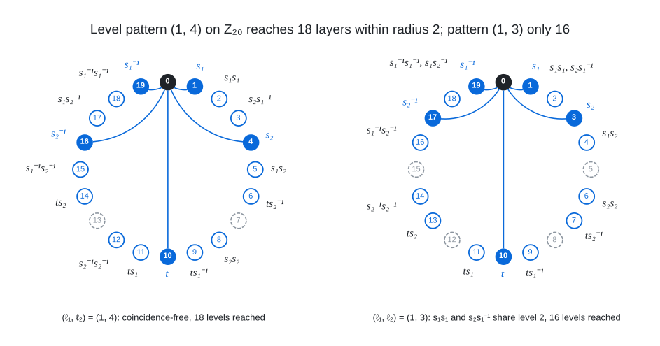

# Cayley Metacyclic Anneal

I anneal connection sets of Cayley graphs on metacyclic groups
$`\mathbb{Z}_N \rtimes_r \mathbb{Z}_M = \langle x, y \mid x^N = y^M = 1,\ y x y^{-1} = x^r \rangle`$ (and voltage
assignments of 2-vertex lifts over them) towards diameter $`D`$, with a bit-parallel BFS as the cost function, level
patterns chosen before the $`x`$-coordinates, targeted moves aimed at unreached vertices, an optional single involution
generator for odd degree, and exact completion sweeps around near-miss states. This family produces the graphs for 37
cells of degree 7 to 16 and diameter 7 to 10 (the cells listed for it in `../HOW_FOUND.tsv`).

<br><sub>A level pattern fixes, before any $`x`$-coordinate is chosen, the levels $`\pm \ell_1, \pm \ell_2`$ of the generators $`s_i = x^{x_i} y^{\ell_i}`$ (and their inverses) on the quotient cycle $`\mathbb{Z}_M`$ (filled, joined to the identity), the involution $`t = x^{t_x} y^{M/2}`$ at level $`M/2`$, and the levels $`\pm 2\ell_i`$, $`\pm \ell_1 \pm \ell_2`$, $`M/2 \pm \ell_i`$ of the reduced words of length 2 (outlined; dashed levels are not reached within radius 2): the pattern $`(1, 4)`$ on $`\mathbb{Z}_{20}`$ is coincidence-free and reaches 18 of the 20 layers, while in $`(1, 3)`$ the words $`s_1 s_1`$ and $`s_2 s_1^{-1}`$ share level 2 and their inverses share level 18, so only 16 layers are reached.</sub>

Files:

- `cayley_sa.c`: the engine (one program: level-pattern sampling and optimisation, simulated annealing, single-slot and
  two-slot exact completion sweeps, the involution machinery, the automorphism quotient `--quot` of mode F); its header
  documents every option.
- `cayley_sa_twoplane.c`: the same search for orders up to about $`3 \times 10^{10}`$ vertices with a two-plane in-place
  BFS (two bits per vertex, under 8 GB), the engine for the graphs from [(9,10)](../../graphs/deg9/dia10) to
  [(16,10)](../../graphs/deg16/dia10); fewer completion modes, same conventions and output.
- `gen_edges_inv.py`: streams the edge list of a one-involution connection set (paste the FOUND line); the even-degree
  edge-list builder is `../cayley_exhaustive/gen_edges.py`. No third-party Python packages are needed.

Inputs are the group $`(N, M, r)`$, the target $`(D, k, c)`$ and options; outputs are text lines `BEST`, `NEAR`, `TIE`,
`IMPROVED` and `FOUND N=.. M=.. r=.. D=.. : x1 y1 x2 y2 ...` (each pair is a generator $`x^{x_i} y^{y_i}`$; with
`--invol` the last pair is the involution). Verify a FOUND line with the verifiers in `tools/` (the implicit Cayley
verifiers take the same `N M r` and generator list) or build the edge list and check it with the all-pairs BFS verifier.

To run it yourself (the control re-finds the known (6,9) Cayley graph on 331387 vertices from its level pattern in
under a second; the second command checks the two-plane engine on the same set):

```
gcc -O3 -march=native -o cayley_sa cayley_sa.c -lm
./cayley_sa 6763 49 41 9 3 0 --ypat 2 18 24 --sa 120 2 100 --ptarget 30 --seed 1
# expected: ... NEAR 0 (...) : 3983 2 4751 18 132 24
#           FOUND N=6763 M=49 r=41 D=9 k=3 c=0 degree 6 n=331387 : 3983 2 4751 18 132 24
#           (root fibre 0 spheres: 1 6 30 150 750 3750 18292 78464 179564 50380  unreached 0)
gcc -O3 -march=native -o cayley_sa_twoplane cayley_sa_twoplane.c -lm
./cayley_sa_twoplane 6763 49 41 9 3 0 0 1 --init 3983 2 4751 18 132 24
# expected: FOUND N=6763 M=49 r=41 D=9 k=3 c=0 degree 6 n=331387 : 3983 2 4751 18 132 24
```

A full-size search is the same command with the group of the target cell, `--invol --tmove 10 --xunit` for odd degree, a
longer `--sa` budget and `--complete 2`; the two-slot completion of a frozen state (modes E and F) is
`--init <state> --sweep2 600 EF --J2 2`.

## Graphs found

- [(7, 9)](../../graphs/deg7/dia9): 1,332,774 vertices
- [(7, 10)](../../graphs/deg7/dia10): 6,641,680 vertices
- [(8, 7)](../../graphs/deg8/dia7): 138,050 vertices
- [(8, 8)](../../graphs/deg8/dia8): 779,803 vertices
- [(8, 9)](../../graphs/deg8/dia9): 4,471,111 vertices
- [(8, 10)](../../graphs/deg8/dia10): 26,864,290 vertices
- [(9, 7)](../../graphs/deg9/dia7): 302,082 vertices
- [(9, 8)](../../graphs/deg9/dia8): 1,961,370 vertices
- [(9, 9)](../../graphs/deg9/dia9): 13,219,318 vertices
- [(9, 10)](../../graphs/deg9/dia10): 89,543,818 vertices
- [(10, 7)](../../graphs/deg10/dia7): 616,915 vertices
- [(10, 8)](../../graphs/deg10/dia8): 4,507,500 vertices
- [(10, 9)](../../graphs/deg10/dia9): 34,182,150 vertices
- [(10, 10)](../../graphs/deg10/dia10): 265,612,889 vertices
- [(11, 7)](../../graphs/deg11/dia7): 1,197,748 vertices
- [(11, 8)](../../graphs/deg11/dia8): 9,739,368 vertices
- [(11, 9)](../../graphs/deg11/dia9): 81,961,120 vertices
- [(11, 10)](../../graphs/deg11/dia10): 697,280,200 vertices
- [(12, 7)](../../graphs/deg12/dia7): 2,114,927 vertices
- [(12, 8)](../../graphs/deg12/dia8): 19,144,241 vertices
- [(12, 9)](../../graphs/deg12/dia9): 177,775,277 vertices
- [(12, 10)](../../graphs/deg12/dia10): 1,692,658,087 vertices
- [(13, 7)](../../graphs/deg13/dia7): 3,691,038 vertices
- [(13, 8)](../../graphs/deg13/dia8): 36,275,160 vertices
- [(13, 9)](../../graphs/deg13/dia9): 362,492,640 vertices
- [(13, 10)](../../graphs/deg13/dia10): 3,789,298,110 vertices
- [(14, 8)](../../graphs/deg14/dia8): 64,298,753 vertices
- [(14, 9)](../../graphs/deg14/dia9): 709,125,173 vertices
- [(14, 10)](../../graphs/deg14/dia10): 8,052,187,457 vertices
- [(15, 7)](../../graphs/deg15/dia7): 9,758,988 vertices
- [(15, 8)](../../graphs/deg15/dia8): 110,115,980 vertices
- [(15, 9)](../../graphs/deg15/dia9): 1,315,107,690 vertices
- [(15, 10)](../../graphs/deg15/dia10): 15,810,645,560 vertices
- [(16, 7)](../../graphs/deg16/dia7): 14,995,367 vertices
- [(16, 8)](../../graphs/deg16/dia8): 185,394,793 vertices
- [(16, 9)](../../graphs/deg16/dia9): 2,343,053,633 vertices
- [(16, 10)](../../graphs/deg16/dia10): 29,899,503,497 vertices
