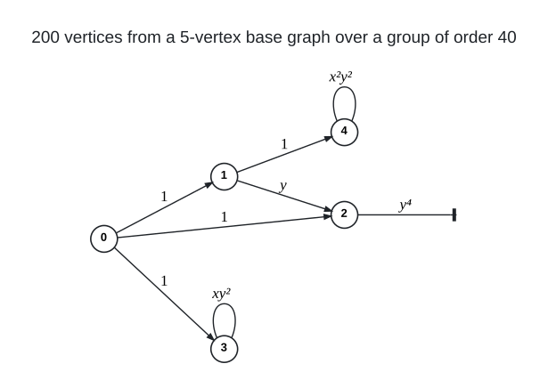

# Cubic Lifts

I sweep regular voltage lifts of small cubic base graphs (multigraphs with loops, parallel edges and semi-edges on $`k`$
vertices) over every group of order $`n/k`$ given by an explicit multiplication table, one representative per orbit of
the group's automorphisms, for cubic graphs of a target diameter; the sweep of the 5-vertex bases over the groups of
order 40 gives the [(3,7)](../../graphs/deg3/dia7) graph on 200 vertices (a lift over
$`\mathbb{Z}_5 \rtimes \mathbb{Z}_8`$); read as a graph rather than as a lift, it is five subdivided Wagner graphs
joined by four 20-cycles of connectors, drawn on its page. At diameter 8 the sweep of the 5-vertex bases over the groups of
order 72 reaches 360 vertices, the lift of $`K_{2,3}`$ with a semi-edge at each vertex of its larger side over
$`\mathbb{F}_3^2 \rtimes Q_8`$, the [(3,8)](../../graphs/deg3/dia8) page; that graph is isomorphic to the 360-vertex entry
of the degree-diameter table (J. Chen's, a symmetric cubic graph on 144 vertices with its edges subdivided and paired),
so it re-derives that entry as a voltage lift rather than adding a new value to the table.

<br><sub>The base of the (3,7) graph: the links $`0 \to 1`$, $`0 \to 2`$, $`0 \to 3`$ and $`1 \to 4`$ carry the trivial voltage (the spanning tree), the link $`1 \to 2`$ carries $`y`$, the semi-edge at 2 the involution $`y^4`$, and the loops at 3 and 4 carry $`x y^2`$ and $`x^2 y^2`$, in $`G = \mathbb{Z}_5 \rtimes_4 \mathbb{Z}_8 = \langle x, y \mid x^5 = y^8 = 1,\ y x y^{-1} = x^4 \rangle`$ of order 40; the lift joins $`(u, g)`$ to $`(v, g a)`$ for every dart $`u \to v`$ with voltage $`a`$, a loop acts both ways and the semi-edge joins $`(v, g)`$ to $`(v, g y^4)`$, so the lift is cubic on $`5 \cdot 40 = 200`$ vertices. In the element numbering of `groups.py` below, $`x^i y^h \mapsto 8 i + h`$, these four voltages are the `1 4 10 18` of the `BEST` line.</sub>

Files:

- `lift.c`: the evaluator and exhaustive enumerator (iterated stabilisers of $`\mathrm{Aut}(G)`$, lexicographically
  minimal representatives, loop voltages identified with their inverses) with `exhaust`, `sample` and `eval` modes; a
  lift vertex $`(u, g)`$ has index $`u\,|G| + g`$.
- `groups.py`: every group of a given order as a multiplication table (cyclic, abelian, direct and semidirect products,
  dicyclic, small permutation and matrix groups), deduplicated by a canonical form of the Cayley-table graph, with
  $`\mathrm{Aut}(G)`$ as permutations, written to `groups/order_<m>/g<i>.txt` plus an index.
- `bases.py`: all connected cubic base pregraphs on $`k`$ vertices up to isomorphism in lift's format
  (`k nslots ntree`, then `u v type` lines, type 0 edge, 1 loop, 2 semi-edge; the first `ntree` slots are a spanning
  tree).
- `cubic_bases.py`: simple cubic base graphs on $`K`$ vertices prefiltered by the non-backtracking walk condition (for
  the larger $`k`$ of the diameter-6 and diameter-8 cells).
- `sweep.py`: applies `lift` to every (group, base) pair of the requested orders and appends JSON lines.

Group elements are numbered by `groups.py` (element 0 is the identity; the (3,7) graph uses the index
$`x^i y^h \mapsto 8 i + h`$ of $`\mathbb{Z}_5 \rtimes \mathbb{Z}_8 = \langle x, y \rangle`$).

To run it yourself (seconds; the group and base enumerations are deterministic, so `groups/order_40/g12.txt` is
$`\mathbb{Z}_5 \rtimes \mathbb{Z}_8`$ with $`|Z(G)| = 4`$ and `bases/b5_0026.txt` is the base with edges 0-1, 0-2, 0-3,
1-4, 1-2, a semi-edge at vertex 2 and loops at vertices 3 and 4; `groups/order_72/g41.txt` is $`\mathbb{F}_3^2 \rtimes Q_8`$ and `bases/b5_0016.txt`
the base $`K_{2,3}`$ with a semi-edge at each of 2, 3 and 4):

```
pip install -r requirements.txt
gcc -O2 -o lift lift.c
python3 groups.py groups 40          # 14 groups of order 40 (the known number), groups/order_40/index.txt
python3 bases.py bases 5             # 43 connected cubic base pregraphs on 5 vertices
./lift groups/order_40/g12.txt bases/b5_0026.txt 7 exhaust 10 sol
# expected: RESULT mode=exhaust m=40 k=5 n=200 D=7 naut=80 ninv=1 nfree=4 evaluated=487 solutions=2 best_defect=0 ...
#           BEST defect=0 voltages: 1 4 10 18          (sol_1.edges and sol_2.edges: 200 vertices, cubic, diameter 7)
python3 groups.py groups 72 && ./lift groups/order_72/g41.txt bases/b5_0016.txt 8 exhaust 10 sol8
# expected: RESULT mode=exhaust m=72 k=5 n=360 D=8 naut=432 ninv=9 nfree=5 evaluated=8891 solutions=4 best_defect=0 ...
#           BEST defect=0 voltages: 1 12 50 58 18      (sol8_1.edges .. sol8_4.edges: 360 vertices, cubic, diameter 8, one graph)
```

A whole-order sweep is `python3 sweep.py --D 7 --n 200 --kmax 8 --groups groups --bases bases`, which needs the
groups of all orders dividing 200 and the bases for every $`k`$.

## Graphs found

- [(3, 7)](../../graphs/deg3/dia7): 200 vertices
- [(3, 8)](../../graphs/deg3/dia8): 360 vertices
