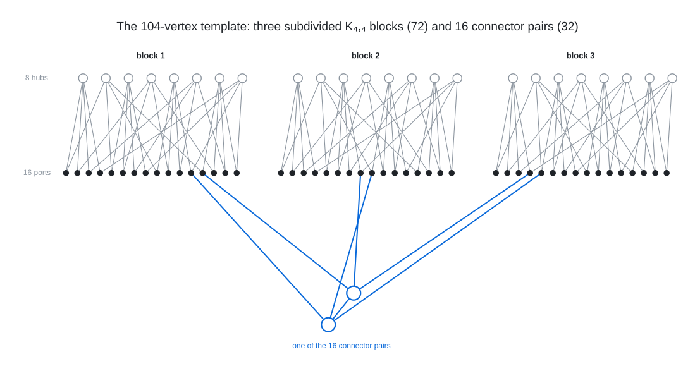

# Degree 4, Diameter 4: The 104-Vertex Graphs And Why The Architecture Stops There

I find 104-vertex graphs of degree 4 and diameter 4 (the [(4,4)](../../graphs/deg4/dia4) cell) with
a voltage-lift search plus a local repair, work out exactly what those graphs are made of, and prove
that nothing larger exists in the same architecture.

Every graph found has the same anatomy: three vertex-disjoint subdivided $`K_{4,4}`$ blocks (8 hubs
and 16 ports each, 72 vertices in all) and 32 connectors in matched pairs, each pair holding two ports
per block. The hub-to-port counting identity makes this architecture tight at 104 vertices, and a
chain of counting lemmas, a port lemma and SAT completions turns that into the following theorems:

- exactly 36 graphs (up to isomorphism) of degree 4 and diameter 4 on 104 vertices contain three
  subdivided $`K_{4,4}`$ blocks with no port-port edge; they are the 36 files in `classes/`;
- no such graph exists on 105, 106, 107 or 108 vertices (three $`K_{4,4}`$ blocks, saturated hubs,
  no port-port edge, any connector structure);
- the 120-vertex all-cross-double design and the 108-vertex four-octahedron design are impossible,
  the former by a short hand proof about orthogonal Latin squares of order 4.

<br><sub>Block $`i`$ has hubs $`L_0, \ldots, L_3`$ and $`R_0, \ldots, R_3`$ and one port $`p_{lr}`$ on every hub pair (one block is drawn with its labels in `proofs/`), and each of the 16 connector pairs holds two ports of every block; the drawn pair is the pure $`(1,1,1)`$ kind, each connector adjacent to its partner and to one port of every block, and the two ports it holds in a block share no hub.</sub>

Directory map:

- `lift_repair/`: the search that finds the 104s (voltage lift over $`\mathbb{Z}_8`$ of a 13-vertex
  base, then symmetry-breaking 2-opt repair), with the saved stall and a positive control.
- `template_calculus/`: the counting side (reach identity, counting relaxation, port lemma, the 54
  skeletons, the two-block and octahedron relaxations) and the independent verifier.
- `sat_closure/`: the SAT encodings and the shape and window enumerations behind the 105 to 108
  closures and the 120 and oct4 impossibilities, with the complete shape lists as data.
- `classes/`: the 36 graphs at 104 as edge lists in a fixed block numbering, with checks.
- `proofs/`: the human-readable theory (TEMPLATE_CALCULUS.md), the 120 proof (PROOF120.md) and
  the soundness note for the refined matching used at 108 (SOUNDNESS_A_PRIME.md).

To run it yourself (Python 3 with `pip install -r requirements.txt`, a C compiler):

```
cd lift_repair && sh run_control.sh && cd ..            # stall at defect 16 -> repaired 104, BFS verified
cd classes && python check_classes.py class*.edges.txt   # 36 files, diameter 4, 36 distinct certificates
cd ../template_calculus && python verify.py corpus       # decomposition and reach identity of all 36
cd ../sat_closure && python sat105.py 104 50 && python sat105.py 105 all   # one SAT 104, then 54 x UNSAT
python typed_sat_shapes.py data/shapes106.json --out=runs/t106.json --cap=600 && python design120.py
```

## Graphs found

- [(4, 4)](../../graphs/deg4/dia4): 104 vertices
