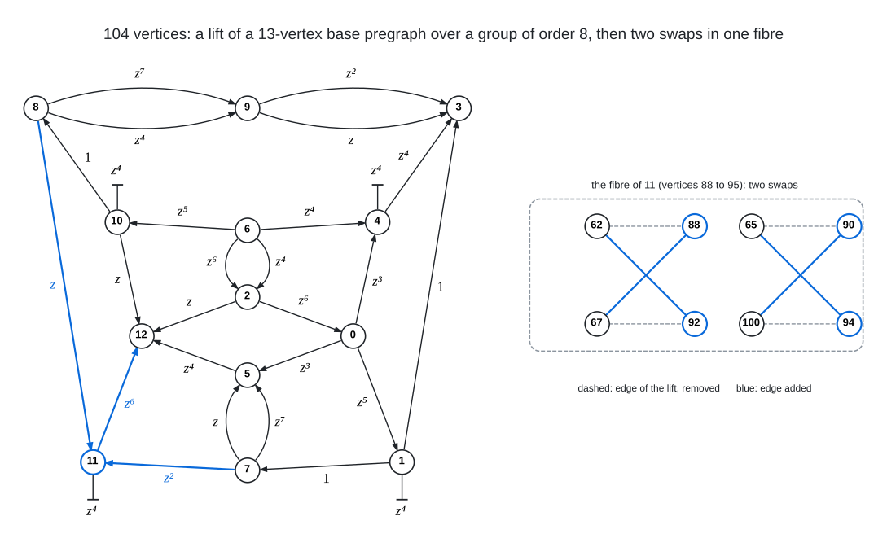

# Voltage Lift Plus 2-Opt Repair (The Search That Finds 104)

I find 104-vertex graphs of degree 4 and diameter 4 by a symmetric voltage-lift search that stalls
at a small defect, followed by a symmetry-breaking 2-opt repair that closes the last pairs. Neither
half works alone: the symmetric search never reaches defect 0 at 104, and plain local search from
scratch walls far below 100.

<br><sub>The base pregraph of the saved stall `z8_b13_defect16.ck`, read from its 28 classes: 24 links, four of them doubled ($`8 \to 9`$, $`9 \to 3`$, $`7 \to 5`$ and $`6 \to 2`$), four semi-edges (the barred stubs at 1, 4, 10 and 11) and no loops, so every base vertex has degree 4 and the lift is 4-regular on $`13 \cdot 8 = 104`$ vertices. Voltages are in $`\mathbb{Z}_8 = \langle z \rangle`$, written multiplicatively ($`z^k`$ is the element $`k`$ of the checkpoint, $`1`$ the identity): a link $`u \to v`$ with voltage $`z^k`$ joins $`(u, h)`$ to $`(v, h z^k)`$ for every $`h \in \mathbb{Z}_8`$, and a semi-edge carries the involution $`z^4`$ and joins $`(v, h)`$ to $`(v, h z^4)`$, a perfect matching on the fibre of $`v`$. Vertex $`8v + h`$ of the lift is $`(v, z^h)`$, so 88 to 95 are the fibre of 11, 62 is $`(7, z^6)`$, 65 and 67 are $`(8, z)`$ and $`(8, z^3)`$, and 100 is $`(12, z^4)`$. With these voltages the lift has defect 16 (8 unordered pairs at distance 5, all inside the fibre of 11), and the repair closes it with the two swaps on the right: 88 and 92 exchange their neighbours 62 and 67, and 90 and 94 exchange 65 and 100, so each of the four rewired edges keeps its base link (one of the three in blue) and moves its end in the fibre of 11 by $`z^4`$. These are the swaps of `run_control.sh` with its default repair seed, and the result is class 9 of `../classes/`; other seeds close the same eight far pairs with other pairs of swaps and land in class 0, 10 or 11 instead.</sub>

- `lift.c`: voltage-lift search. A base pregraph on $`B`$ vertices with link, loop and semi-edge
  classes carries voltages in a finite group (cyclic, dihedral, dicyclic, Frobenius, products);
  the lift on $`B \cdot |G|`$ vertices is 4-regular when every base vertex has degree 4 counting a
  loop twice. The defect (ordered pairs at distance $`> 4`$) is evaluated from orbit representatives
  with bitset ball expansion; moves are defect-targeted voltage changes, an exhaustive polish over
  all class voltages and endpoint swaps, link/semi-edge conversions, and basin hopping from the
  best state. Usage: `./lift GROUP B F SEED SECONDS CKPT` (`cyc:8 13 0` is the geometry of the
  104s: $`\mathbb{Z}_8`$ over 13 base vertices, no fixed vertices); `SECONDS = 0` dumps the
  checkpoint's graph.
- `repair.c`: plain 2-opt / 3-opt descent on the full graph with no symmetry, targeted at the
  vertices that still have far pairs, with kicks from the best state. Usage:
  `./repair EDGES SEED SECONDS BEST` (extra modes: `a` anneal, `g` exhaustive single-vertex
  insertion, `2` double insertion, `w` plateau walk).
- `z8_b13_defect16.ck`: the saved stall, a $`\mathbb{Z}_8`$ lift of a 13-vertex base with 28
  classes at defect 16 (8 unordered pairs in one fibre); the repair closes it in under a second,
  landing in class 0, 9, 10 or 11 of `../classes/`.
- `run_control.sh`: compiles everything, dumps the stall, repairs it and verifies the result with
  the repository's all-pairs BFS verifier, `tools/verify/verify_bfs.c`.

The lift search is a stochastic basin-hopping search: a one-minute `./lift cyc:8 13 0 SEED 60 x.ck`
reaches a defect of 30 to 180 for most values of `SEED` and a stall at defect $`\le 24`$, where the
repair can take over, for roughly one value in eighty. The saved stall makes the control independent
of that.

To run it yourself:

```
sh run_control.sh            # dump the stall (defect 16), repair to 0, verify by BFS
sh run_control.sh 5          # a different repair seed; expect "unordered pairs at distance > 4: 0"
./lift cyc:8 13 0 123 60 s123.ck    # a fresh one-minute lift search from seed 123
./repair s123.ck.edges 1 60 out.edges   # worth trying when the lift stalled at defect <= 24
```
