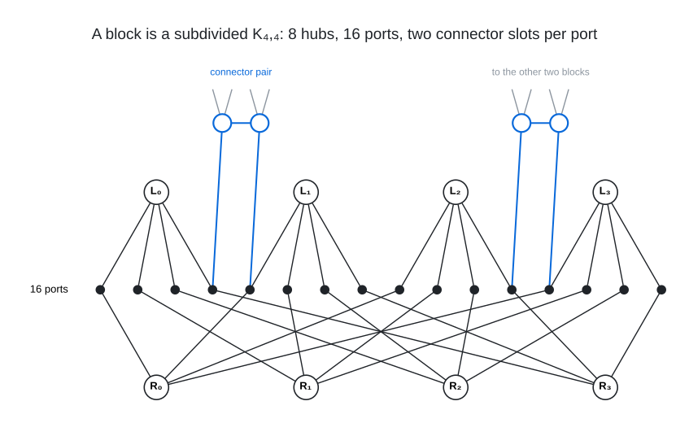
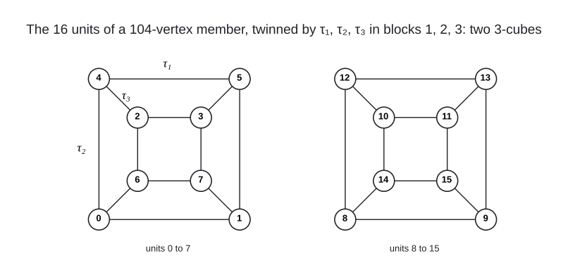
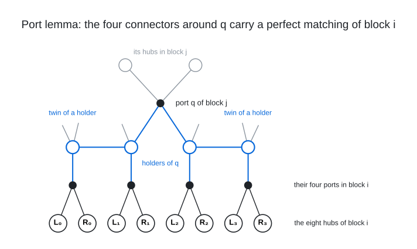

# Proofs

Three notes carry the theory behind the 104 classification and the 105 to 108 closures; the
scripts they cite are in `../template_calculus/` and `../sat_closure/`.

 A block (section 1 of `TEMPLATE_CALCULUS.md`): hubs $`L_0, \ldots, L_3`$ and $`R_0, \ldots, R_3`$, the port $`p_{lr}`$ of every hub pair at position $`4l + r`$, and the two free slots of each port, here filled on four ports by two of the 16 connector pairs; a connector of the pure kind is adjacent to its partner and to one port of every block (the grey stubs lead to the other two blocks).

 The unit design of section 8: the 16 units, each owning two ports in every block, are paired into twins by the fixed-point-free involutions $`\tau_1, \tau_2, \tau_3`$ (one per block, drawn as the three edge directions); in skeletons 50, 51 and 53, the only ones with 104-vertex completions, the three involutions commute and split the units into two 3-cubes, and the skeletons differ only in their side and label patterns.

 The only routes from a hub $`a`$ of block $`i`$ to a port $`q`$ of block $`j`$ (section 7) are $`a - p - c - q`$ and $`a - p - c - c' - q`$ through the two holders $`c`$ of $`q`$ and their connector neighbours $`c'`$, so in a tight member the block-$`i`$ ports of these four connectors are four distinct ports forming a perfect matching of $`K_{4,4}(i)`$, one route to $`q`$ from every hub (grey stubs: the edges to the third block and the twins' own block-$`j`$ ports).

Files:

- `TEMPLATE_CALCULUS.md`: the template calculus for the three-$`K_{4,4}`$-block family. Sections 1-10
  derive the hub-to-port identity, the counting relaxation, the port lemma, the structure theorem
  (54 skeletons) and the completion SAT, and prove that no 105-vertex member exists. Section 11
  settles the 120-vertex all-cross-double shape, 11b the four-octahedron design at 108, and section
  13 collects the closures at 106, 107 and 108 (potential function, component and window
  enumerations, typed SAT, parity of the budget).
- `PROOF120.md`: the hand proof that the reduced 120 puzzle has no solution: the four partition
  families force the three orthogonal-array bijections to commute, and a composite of two OA
  bijections is never an OA bijection because that would need four MOLS of order 4.
- `SOUNDNESS_A_PRIME.md`: why the refined excess matching used to filter the 108 shape lists is a
  necessary condition for every member at every budget.
