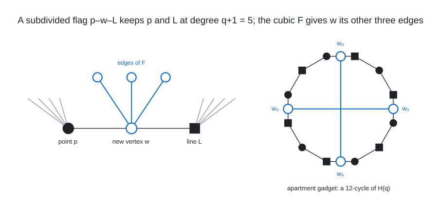

# Hexagon Insertion

I extend the incidence graph of the split Cayley hexagon $`H(q)`$ (points and lines of the parabolic quadric
$`Q(6, q)`$, $`(q+1)`$-regular, bipartite, girth 12, diameter 6) by subdividing a set $`S`$ of $`m`$ flags (incidence
edges) with new vertices and adding a graph $`F`$ on the new vertices (2-regular for $`q = 3`$, cubic for $`q = 4`$), so
the result is $`(q+1)`$-regular on $`2(q^6 - 1)/(q - 1) + m`$ vertices with diameter 6; $`S`$ and $`F`$ are annealed
against the exact number of vertex pairs at distance greater than 6, computed incrementally from the hexagon's unique
geodesics. For $`q = 3`$ the flag set is an orbit (or a union of two orbits) of a subgroup of the hexagon's automorphism
group and only $`F`$ is annealed (the [(4,6)](../../graphs/deg4/dia6) graph, 760 vertices); for $`q = 4`$ the cubic
$`F`$ is annealed and then $`S`$ is found by min-conflicts relocation with $`F`$ fixed (the
[(5,6)](../../graphs/deg5/dia6) graph, 2836 vertices).

<br><sub>A point-line incidence edge $`p - L`$ is replaced by the path $`p - w - L`$ through a new vertex $`w`$, which keeps $`p`$ and $`L`$ at degree $`q + 1 = 5`$ and gives $`w`$ degree 2, and the cubic graph $`F`$ on the new vertices supplies the other three edges of every $`w`$; an apartment gadget (`--apts`) is a 12-cycle of $`H(q)`$ whose flags at positions 0, 3, 6, 9 are subdivided, with the two antipodal pairs $`w_0 w_6`$ and $`w_3 w_9`$ joined in $`F`$, a group with no far pairs of its own (the other edges of the cycle vertices and the remaining two $`F`$-edges of each $`w_i`$ are not drawn).</sub>

Files:

- `hexagon_incidence.c`: builds $`H(q)`$ for $`q \in \{3, 4, 5, 7, 8, 9\}`$ as an edge list (points $`0, \ldots, P-1`$,
  lines $`P, \ldots, 2P-1`$) and writes the point coordinates with `--points`; the numbering of the (5,6) graph is
  exactly this program's $`q = 4`$ output.
- `orbit_sa.c`: the $`q = 3`$ annealer ($`S`$ fixed or free, $`F`$ a 2-factor), exact incremental cost, `--fixS`,
  `--Flist` batch evaluation of many $`F`$ per $`S`$.
- `hexagon_sa.c`: the $`q = 4`$ annealer with the exact fast cost, min-conflicts flag relocation with $`F`$ fixed, frozen
  $`F`$, apartment gadgets, exact 1- to 3-move neighbourhoods of a low-cost state and `--eval`.
- `flags_760_h3.txt`: the 32 flags of the (4,6) graph in the numbering of `hexagon_incidence 3`; `flags_2836_h4.txt`,
  `cubic_f_2836.txt`: the 106 flags and 159 $`F`$-edges of the (5,6) graph (an $`F`$ edge `i j` joins new vertices
  $`2730 + i`$, $`2730 + j`$).

The orbit enumeration behind `flags_760_h3.txt` (subgroup lattices of the hexagon's automorphism group, orbits on
flags) is not staged; it depends on a precomputed library of configuration classes. The flag set is given explicitly.

To run it yourself (the control rebuilds $`H(3)`$, anneals a 2-factor on the (4,6) flag set and reaches a 760-vertex
graph of diameter 6 in a few seconds; the second block re-evaluates the (5,6) graph exactly):

```
gcc -O2 -o hexagon_incidence hexagon_incidence.c
./hexagon_incidence 3 H3.edges --points H3_points.txt && ./hexagon_incidence 4 H4.edges --points H4_points.txt
gcc -O2 -o orbit_sa orbit_sa.c -lm && mkdir -p out && ./orbit_sa H3.edges 32 0 1 60 --fixS flags_760_h3.txt --tag ctrl760 --outdir out
# expected: FINAL best=0 (no 0 nn 0 oo 0) exact=0 ... n=760 maxdeg=4 mindeg=4   and out/ctrl760_n760_*.edges
gcc -O3 -march=native -o hexagon_sa hexagon_sa.c -lm && ./hexagon_sa H4.edges 106 0 1 1 --initS flags_2836_h4.txt --initF cubic_f_2836.txt --eval --outdir out --tag ctrl2836
# expected: bfs-method cost 0 (no 0 nn 0 oo 0); exact all-pairs BFS: pairs > 6 = 0, max degree 5, min degree 5, n = 2836
```

Verify any output edge list with the all-pairs BFS verifier in `tools/`. A free search is `./hexagon_sa H4.edges 106 0
<seed> <seconds>`; the flag set $`S`$ of the (5,6) graph comes from the min-conflicts relocation with `--fixF` on a
cubic $`F`$ annealed beforehand.

## Graphs found

- [(4, 6)](../../graphs/deg4/dia6): 760 vertices
- [(5, 6)](../../graphs/deg5/dia6): 2,836 vertices
