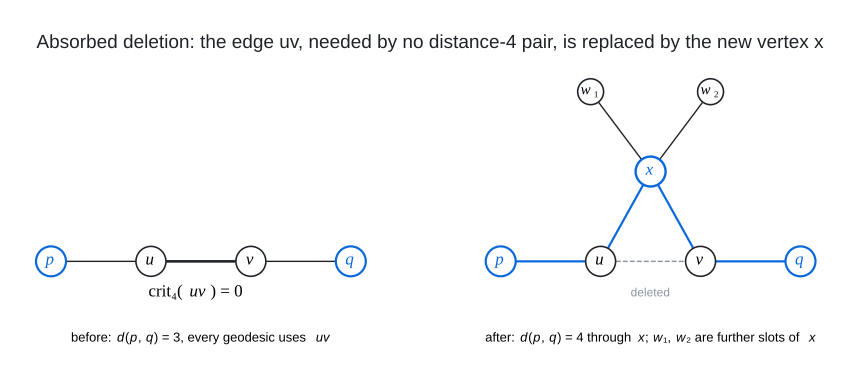

# Insert Grow

I grow a graph of maximum degree $`\Delta`$ and diameter $`D`$ one vertex at a time by absorbed deletions: the new
vertex $`x`$ takes an edge $`uv`$ on which no pair at distance $`D`$ depends, the edge is deleted and $`x`$ is joined
to $`u`$, to $`v`$ and to further vertices with a free slot, so that every pair that used $`uv`$ is re-routed through
$`x`$ one step longer and $`x`$ itself reaches everything within $`D`$; when a cheap edge is not quite free, the few
pairs its deletion pushes beyond $`D`$ are repaired exactly by a SAT completion, and in the end a SAT model chooses
the deletion set and the neighbourhood together. The [(11,4)](../../graphs/deg11/dia4) graph (3645 vertices, maximum
degree 11) is 201 such steps into a 3444-vertex graph from the degree-diameter table, a $`\mathbb{Z}_2`$ double of
the $`W(9)`$ incidence graph with the two copies of every line joined and 164 twins on a spread of 82 lines; the
base vertices keep their degree throughout.

<br><sub>Left: an edge $`uv`$ with $`\mathrm{crit}_4(uv) = 0`$, so every pair whose geodesics all use $`uv`$ is at distance at most 3, like $`p, q`$. Right: $`uv`$ is deleted and the new vertex $`x`$ is joined to $`u`$, $`v`$ and further vertices with a free slot ($`w_1, w_2`$, or the endpoints of a second absorbed edge); the pair $`p, q`$ is re-routed through $`x`$ at length 4, no pair at distance 4 depended on $`uv`$, and $`x`$ is within 4 of every vertex when the radius-3 balls of its neighbours cover the graph.</sub>

The criticality $`\mathrm{crit}_D(e)`$ of an edge is the number of unordered pairs at distance exactly $`D`$ all of
whose geodesics use $`e`$; it is computed exactly for every edge by one BFS per vertex that carries along the BFS
DAG the set of edges common to all shortest paths (`gtool crit`). An edge with $`\mathrm{crit}_D = 0`$ is
absorbable: after the deletion every pair that depended on it was at distance at most $`D - 1`$ and gets the path
through $`x`$ of length at most $`D`$, so the only remaining condition is that the radius-$`(D-1)`$ balls of
$`N(x)`$ cover the vertex set, a greedy maximum-coverage choice with $`\Delta`$ slots (two per absorbed edge, one
per free slot). The exact completion (`insert4.py`) takes a fixed deletion set and $`k`$ new vertices and encodes,
with CaDiCaL, the variables new-old and new-new adjacency, the far pairs of the deleted graph (each needs a repair
path through a new vertex, enumerated explicitly from the precomputed distances), every old vertex within $`D`$ of
every new vertex, and the degree and slot cardinalities. The selection model (`grow_sel.py`) goes one step further:
its pool is the edges with $`\mathrm{crit}_D`$ up to a bound, for each of which `farsets` lists exactly the pairs
that its deletion alone pushes beyond $`D`$, and the solver chooses which pool edges to delete and which of their
endpoints and free slots $`x`$ takes, under the constraints that a slot needs a deletion or a free slot, that
every pair created by a chosen deletion has a repair route through $`x`$, and that every vertex is within
$`D - 1`$ of $`N(x)`$; pairs created jointly by several deletions are not modelled, so every model is verified by an
all-pairs BFS (`gtool far`, then the verifier in `tools/`) and a failing deletion set is blocked. In the $`W(9)`$
double both copies of a base point 3-cover every line copy and twin and both copies of a base line 3-cover every
point copy, so $`x`$ adjacent to the two copies of a point, their twins and the two copies of a line sees
everything; the absorbed lines must be pairwise skew (a partial spread of $`W(9)`$), which is why single-edge
absorption stops near 3530, and the twins' capacity (each tolerates one or two absorbed points before the far
pairs outrun what a degree-11 vertex can repair) bounds the family at about 3650 to 3750.

Files:

- `gtool.c`: BFS utilities on an edge list: `crit` (per-edge $`\mathrm{crit}_d`$ for $`d \le D`$), `far` (pairs
  beyond $`D`$ after optional deletions), `dist`, `ecc`, `cover` (greedy coverage by radius-$`R`$ balls).
- `grow.c`: greedy iterated insertion: criticality, absorbable edges (or edges with $`\mathrm{crit}_D`$ up to
  `CMAX`) and free slots as items, greedy cover, all-pairs check, new-new repair edges, one accepted graph per step
  (`PREFIX_<n>.edges`, log of deleted edges and $`N(x)`$).
- `insert4.py`: the exact SAT completion (`--base G --delete "a-b,c-d" --k 1 --D 4 --delta 11`), prints `RESULT`
  and, after its own re-check, `!!! SAT n=<n> file=<out>`.
- `farsets.c`: the pairs that deleting one edge pushes beyond $`D`$, exactly (candidates from the BFS DAGs, each
  re-checked by a BFS in $`G - e`$), for every edge of a pool.
- `grow_sel.py`: the selection model (`START.edges PREFIX --delta 11 --D 4 --cmax 4 --pool 200 --fcap 60`), with an
  escalation ladder after an UNSAT or a timeout (larger pool, larger caps, `--n0` to try no deletions inside the
  inserted layer first), one `STEP` line per accepted vertex and a witness file of every step.
- `grow_sat.py`: SAT-assisted iterated insertion for the $`W(9)`$ double (points `0..1639`, lines `1640..3279`, twins
  `3280..3443`): deletes the two point-twin edges at the copies of a base point and a line-line or twin-twin edge with
  $`\mathrm{crit}_4 \le`$ `cmax`, and asks `insert4.py` for one new vertex.
- `rebuild_chain.py`: replays a base edge list and step lists (`grow.c` logs or `grow_sel.py` witnesses) into the
  grown graph, with no search code.

The 201 steps of the (11,4) graph are in its [`insertions.txt`](../../graphs/deg11/dia4/insertions.txt): the first
67 absorb single edges (11 structured, 24 by `grow.c`, 32 by `grow_sat.py`), the next 21 are `grow.c` steps with
`CMAX` 4, and the last 113 are selection-model steps. To run it yourself (the first control rebuilds the 3444-vertex
start and takes three greedy steps; the second undoes the last step of the chain and lets the exact completion
re-find it, the same new vertex with the same neighbourhood and the graph's edge file byte for byte; the third
rebuilds the graph at 3532 vertices, where single-edge absorption had saturated, and lets the selection model take
a step):

```
gcc -O2 -o gtool gtool.c && gcc -O2 -o grow grow.c && gcc -O2 -o farsets farsets.c && gcc -O2 -o verify_bfs ../../tools/verify/verify_bfs.c && pip install -r requirements.txt
G=../../graphs/deg11/dia4/deg11-dia4-n3645.edges.txt; I=../../graphs/deg11/dia4/insertions.txt
for M in 3444 3532 3644; do awk -v M=$M 'NF == 2 && !/^#/ && $1 < M && $2 < M' $G > g$M.edges; awk -v M=$M '/^[0-9]+:/ && $1 + 0 >= M { for (i = 3; i <= NF && $i != "joined"; i++) { gsub(";", "", $i); split($i, e, "-"); if (e[1] < M && e[2] < M) print e[1], e[2] } }' $I >> g$M.edges; done
./grow g3444.edges 11 4 3 grown 1
# expected: step 1: n=3444 absorbable edges 1782, free-slot vertices 0 ... accepted trial 0: n=3445, x degree 4, 2 deletions
#           ... final n=3447; grown_3447.edges has 3447 vertices, maximum degree 11 and diameter 4
python3 insert4.py --base g3644.edges --D 4 --delta 11 --k 1 --delete "694-1787,3474-3492,3463-3589,3489-3539,695-1786" --out step.edges
# expected: # new vertex 3644: N = [694, 695, 1786, 1787, 3463, 3474, 3492, 3539, 3588, 3589, 3609]
#           !!! SAT n=3645 file=step.edges
python3 grow_sel.py g3532.edges sel --delta 11 --D 4 --cmax 4 --pool 200 --fcap 60 --steps 1
# expected: n=3532 pool 145 edges (crit<=4, |F_e|<=60, 461 far pairs), |S|=113, free slots 46 ... STEP n=3533 new vertex 3532 (degree 11) ... FOUND n=3533
```

`step.edges` is the (11,4) graph itself (the same sorted edge list); verify any output with the all-pairs BFS
verifier in `tools/`. A full run is `./grow START.edges 11 4 1000 out` until the greedy cover fails, then
`grow_sel.py out_cur.edges sel --delta 11 --D 4` with the pool bounds raised as the steps run out (`--cmax 40
--pool 1000 --fcap 300 --n0 3444`), and `rebuild_chain.py START.edges final.edges out.log sel.witness.txt` to
confirm the chain against the final edge list.

## Graphs found

- [(11, 4)](../../graphs/deg11/dia4): 3,645 vertices
