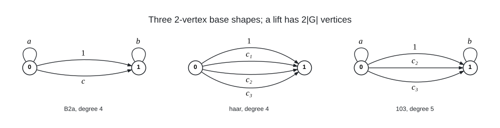

# Lift Two Vertex

I sweep voltage assignments of 2-vertex base graphs (loops, parallel links and semi-edges at two base vertices) over
metacyclic groups $`G(N, M, r, t) = \langle x, y \mid x^N = 1,\ y^M = x^t,\ y x y^{-1} = x^r \rangle`$, reduced by the
automorphisms of the group and the symmetries of the base graph, and evaluate every candidate with a bit-parallel BFS
(one bitset per base vertex). The degree-4 shape with a loop at each vertex and two links gives the
[(4,10)](../../graphs/deg4/dia10) graph; the degree-5 shape 103 (a loop at each vertex, three links, one trivial) gives
the [(5,8)](../../graphs/deg5/dia8), [(5,9)](../../graphs/deg5/dia9) and [(5,10)](../../graphs/deg5/dia10) graphs.



Voltage slots of the three named shapes: loops $`a`$ at vertex 0 and $`b`$ at vertex 1, the spanning-tree link with voltage 1, and the free links $`c`$ (B2a), $`c_1, c_2, c_3`$ (haar) or $`c_2, c_3`$ (103); the lift over $`G`$ joins $`(u, g)`$ to $`(v, g a)`$ for every dart $`u \to v`$ with voltage $`a`$ and every $`g \in G`$, so it has $`2|G|`$ vertices and the same degree as the base.

Files:

- `bitlift.c`: the evaluator and prefix sweeper for any base spec (`k=2;deg=5;loop:0;link*:0,1;link:0,1;link:0,1;loop:1`
  is shape 103); the row width `NW` $`= \lceil N/64 \rceil`$ is a compile-time constant. The default BFS kernels need
  AVX-512; add `-DKERNEL=0` for the portable scalar kernel (same results, slower).
- `gen_prefix.py`: reduced candidate prefixes for an arbitrary base spec (sequential stabilisers of the automorphism
  group $`A`$, loop inversion, parallel-slot ordering, vertex chain rules).
- `gen_b2.py`, `check_b2.py`: the named degree-4 and degree-5 two-vertex shapes (B2a, haar, 103, H5, L1, semi-edge
  shapes) with the vertex-swap rule, $`t`$-aware; brute-force orbit-coverage check on small groups.
- `gen103.py`, `gen_sub.py`: the fully $`S_3`$-reduced shape-103 family (link permutations by re-gauging at vertex 1) and
  its sub-blocks $`(i, j)`$ of fixed loop layers, in $`O(|G|)`$ memory for the large groups.
- `rank_patterns.py`, `pattern_features.py`: the R1 pattern filter on the $`2M`$-vertex quotient (quotient girth, full
  spheres of radius 1, score ratio) that ranks sub-blocks and link-level patterns before a sweep.
- `make_edges.py`: independent edge-list builder for a 2-vertex lift (lift vertex $`(v, g)`$ has index
  $`v\,|G| + \mathrm{index}(g)`$).

Prefix lines are `v1 .. v_{f-1} lo hi` (the last free slot ranges over $`[\mathrm{lo}, \mathrm{hi})`$); voltages are
element indices $`i + N j`$.
Output lines: `NEAR defect=d voltages=[..]`, `FOUND diam<=D (defect 0) ... voltages=[..]`, `EXHAUSTIVE ... complete=1`.
Verify a FOUND with `make_edges.py` and the all-pairs BFS verifier in `tools/` (or the implicit lift verifier there).

To run it yourself (the control sweeps the complete degree-4 family with a loop at each vertex and two links over
$`\mathbb{Z}_{197} \rtimes_{16} \mathbb{Z}_{49}`$ and re-finds the (4,10) graphs on 19306 vertices, 10 assignments = 5 up
to inverting the free link):

```
pip install -r requirements.txt && python3 gen_b2.py 197 49 16 0 B2a > pref_b2a.txt     # 160108 lines, 3055708 candidates
gcc -O3 -march=native -DNW=4 -o bitlift_nw4 bitlift.c -lm && ./bitlift_nw4 --meta 197 49 16 --base "k=2;deg=4;loop:0;loop:1;link*:0,1;link:0,1" --D 10 --mode prefix --prefix pref_b2a.txt --report 2
# expected: FOUND diam<=10 (defect 0) group=Z197 x|_16 Z49 ... voltages=[197,1971,0,2439]   (and 9 more FOUND lines)
#           EXHAUSTIVE ... candidates=3055408 ... best_defect=0 ... found=10 complete=1
```

`make_edges.py 197 49 16 0 "<spec>" "[197,1971,0,2439]" 19306.edges` writes the edge list. A shape-103 sub-block sweep is
`gen_sub.py N M r i j > pref.txt` plus the same bitlift command with `--base "k=2;deg=5;loop:0;link*:0,1;link:0,1;link:0,1;loop:1"`;
`rank_patterns.py N M r D` ranks the sub-blocks beforehand.

## Graphs found

- [(4, 10)](../../graphs/deg4/dia10): 19,306 vertices
- [(5, 8)](../../graphs/deg5/dia8): 18,810 vertices
- [(5, 9)](../../graphs/deg5/dia9): 60,686 vertices
- [(5, 10)](../../graphs/deg5/dia10): 202,550 vertices
