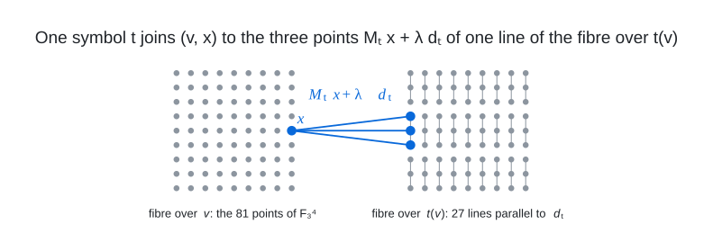

# Route Chart Lifts

I build graphs as route-chart lifts: a small controller graph $`C`$ whose darts carry symbols (two permutations
$`a, b`$ and their inverses, optionally a self-inverse symbol $`s`$ or a plain symbol), a fibre
$`\mathbb{F}_3^4`$ over every controller vertex (81 points; $`\mathbb{F}_3^3`$ at diameter 3), and for every
symbol $`t`$ a chart $`(M_t, d_t)`$ with the lift rule $`(v, x) \sim (t(v),\ M_t x + \lambda d_t)`$ for
$`\lambda \in \mathbb{F}_3`$, so a symbol gives every lift vertex three neighbours (one for a plain symbol) and
the lift has $`81\,|C|`$ vertices. The controller is searched for the walk conditions the chart needs, the chart
is searched for the controller, and the diameter is certified by a BFS of the lift. This gives the
[(12,4)](../../graphs/deg12/dia4), [(13,4)](../../graphs/deg13/dia4), [(14,4)](../../graphs/deg14/dia4),
[(15,4)](../../graphs/deg15/dia4) and [(15,3)](../../graphs/deg15/dia3) graphs.

<br><sub>Controllers are regular lifts of a $`k`$-vertex Schreier base over a small group $`G`$: a dart $`c \to t(c)`$ with voltage $`g`$ joins $`(c, h)`$ to $`(t(c), h + g)`$ for every $`h \in G`$ and carries the symbol $`t`$. The (12,4) controller is this base over $`\mathbb{Z}_{19}`$ (76 vertices, 4-regular); the (15,4) controller is a 4-vertex base with a third permutation, the matching $`s`$, over $`\mathbb{Z}_{42}`$ (168 vertices, 5-regular), the (15,3) controller a 3-vertex base over $`\mathbb{Z}_{20}`$ (60 vertices, 5-regular), and the (13,4) and (14,4) controllers are Cayley graphs ($`k = 1`$) of $`\mathbb{Z}_7 \rtimes_2 \mathbb{Z}_{12}`$ and $`SL(2,3) \times \mathbb{Z}_5`$ with a central plain symbol; the pages of the three lifted controllers draw their bases.</sub>

<br><sub>The fibre over $`v`$ and the fibre over $`t(v)`$ are both $`\mathbb{F}_3^4`$ (drawn as $`9 \times 9`$ grids); the symbol $`t`$ sends $`x`$ to the three points $`M_t x + \lambda d_t`$, which form one line of the parallel class of $`d_t`$ in the target fibre, and every point of the target fibre lies on exactly one such line, so the symbol contributes 3 to the degree and the relation is symmetric when $`M_{t^{-1}} = M_t^{-1}`$ and $`d_{t^{-1}} = M_t^{-1} d_t`$.</sub>

A walk with word $`t_1 t_2 t_3 t_4`$ maps the fibre of its start affinely onto a subspace of its target fibre
spanned by the columns $`M_{t_4} M_{t_3} M_{t_2} d_{t_1}`$, $`M_{t_4} M_{t_3} d_{t_2}`$, $`M_{t_4} d_{t_3}`$,
$`d_{t_4}`$; the word is controllable when this matrix has rank 4, and then one walk covers all 81 points of the
target fibre. So a pair of controller vertices at distance 4 needs a controllable geodesic word, a pair at distance
1 or 3 a non-backtracking walk of length 4 with a controllable word (the controller condition tested by the
sweeps), and the pairs at distance 0 and 2 are covered by chart-only conditions: the planes of the backtracking
closed walks $`t t^{-1} u u^{-1}`$ and $`t u u^{-1} t^{-1}`$ must cover the own fibre, and the pencil of
hyperplanes through the plane of a geodesic 2-word must be completed by the directions of its one-backtrack walks.
A self-inverse symbol needs $`M_s^2 = I`$ and $`M_s d_s = d_s`$. A plain symbol $`q`$ acts as
$`(v, x) \sim (q(v), M_q x + c_q)`$ with one neighbour; its voltage is a central element $`z`$ of $`G`$ and its
chart a scalar, $`M_q = \pm I`$, so that the four insertions of the plain letter into a line 3-word reach the same
fibre as cosets of one hyperplane and tile it when their residues cover $`\mathbb{F}_3`$ (the tiling principle),
which gives degree $`4 \times 3 + 1 = 13`$ with a central involution and $`4 \times 3 + 2 = 14`$ with a central
pair of order 5. At diameter 3 the cells are $`\mathbb{F}_3^3`$ and the charts are per dart, not per symbol: the
five departure lines of every vertex are four points on a projective line of $`PG(2,3)`$ plus one special point,
the controller must have $`A^3 + A > 0`$ (every vertex on a triangle, every non-adjacent ordered pair joined by a
3-walk), and a SAT over the per-edge types (which in-dart of a special edge is sent to which plane) chooses charts
that leave every pair a full-rank 3-walk; the matrices of each type are then realised by a brute-force search in
$`GL(3,3)`$.

Files:

- `rclift.c`: the lift evaluator for a controller with per-dart chart ids (any alphabet): degrees, symmetry of the
  relation, diameter, far pairs, `--edges`.
- `ctrl_lift.c`: controller sweep for the 4-symbol alphabet: all voltage assignments of a $`k`$-vertex Schreier base
  over a group table, word filter (every pair at distance 1, 3, 4 has a non-backtracking 4-walk whose word is not in
  the chart's bad-word list) or `--chart` exact coverage from the roots.
- `ctrl5.c`: the same for the 5-symbol alphabet (`anyword` filter, `--dump` of the word masks of every pair for the
  co-design, `--only` for one assignment); `cdsa.c`: the chart co-design, simulated annealing over the five charts
  against a pool of dumped controllers, whose objective is the number of controller pairs without a controllable word
  plus the two chart-only defects, zero meaning every pair of fibres is covered.
- `exlift.c`: exact evaluator and chart annealer for general alphabets (pairs, self-inverse, plain) from a controller
  file (`ctrl.py` writes it), bit-parallel BFS from the deck-representative roots, `--eval`, `--edges`.
- `mixctrl.c`, `mixlift.c`: the mixed alphabets with central plain symbols: screen of a group's $`(a, b)`$ pairs for
  the hard-deficit condition (every needed pair has a line 4-word or a tiling), and the exact lift annealer / evaluator.
- `ctrl3.c`, `typesat3.py`: diameter 3: the $`A^3 + A > 0`$ controller sweep (writes `.ctrl` files) and the per-edge
  type SAT with its $`GL(3,3)`$ realisation and lift (python-sat).
- `univ.c`: chart-only annealing for universal charts (every reduced 4-word controllable).
- `extract_chart.py`: reads the controller and the charts off the edge list of a route-chart lift; `alph.py`, `rcl.py`:
  charts, words, the chart-only scores and the `rclift` input; `chartio.py`: cdsa chart text to json and `verify`
  (controller + chart to lift through `rclift`); `ctrl.py`: controllers from Schreier data; `groups.py`: group tables.
- `build_6156.py`, `build_6804.py`, `build_9720.py`, `build_13608.py`, `build_1620.py`: self-contained constructions
  of the five graphs (sorted edge list to the file named on the command line; `build_1620.py` reads
  `charts_1620_15_3.json`), `chart_6156.txt`, `chart_13608.txt`, `chart_6804.txt`, `chart_9720.txt`,
  `badwords_6156.txt`: the charts of the graphs in the evaluators' formats and the bad-word list of the (12,4) chart,
  the words that the controller sweep for that cell must avoid.

To run it yourself (the builds write each graph; the sweeps re-find the (12,4) controller among 72
with the chart fixed, the (13,4) controller first among 84 and the (15,3) controller among 192, and
the type SAT and the evaluators rebuild the graphs from controller and chart):

```
for n in 6156 6804 9720 13608 1620; do python3 build_$n.py lift_$n.edges; done
# expected: vertices 6156 edges 36936 / 6804 44226 / 9720 68040 / 13608 102060 / 1620 12150
for c in rclift ctrl_lift ctrl5 cdsa exlift mixctrl mixlift ctrl3 univ; do gcc -O2 -o $c $c.c -lm; done && pip install -r requirements.txt
for n in 19 20 42 84 120; do python3 groups.py write $n groups; done
./ctrl_lift 4 1,2,3,0 1,3,0,2 groups/19_Z19.tbl badwords_6156.txt --maxout 80
# expected: HIT chart=0 va=0,12,4,0 vb=17,0,0,1 ... hits=72
python3 ctrl.py groups/19_Z19.tbl 4 1,2,3,0 1,3,0,2 - 0,12,4,0 17,0,0,1 - c76.ctrl && ./exlift c76.ctrl --m 4 --eval --init chart_6156.txt --edges ex_6156.edges
# expected: objective 0 ... n 6156 deg 12; ex_6156.edges equals lift_6156.edges
./ctrl5 4 1,2,3,0 1,2,3,0 2,3,0,1 groups/42_Z42.tbl --only 9,12,19,38,7,41,21 --dump one.dump && ./cdsa one.dump 0 1 --init chart_13608.txt --out cd.txt
# expected: HIT ... va=0,9,12,0 vb=19,38,7,41 vs=0,21,0,0   and   RESULT unc=0 c0=0 c2=0
python3 chartio.py verify cd.txt 4 1,2,3,0 1,2,3,0 2,3,0,1 groups/42_Z42.tbl
# expected: ... written verify_13608.edges (equal to lift_13608.edges)
./mixctrl 1 0 0 groups/84_Z7:2:Z12.tbl --plain inv 42
# expected: OK va=8 vb=28 ... first; mixedOK=84 best_deficit=0
./mixlift groups/84_Z7:2:Z12.tbl 1 0 0 "va=8 vb=28" --plain inv 42 0 1 --init chart_6804.txt --eval
# expected: unc=0 far_ordered=0
./ctrl3 3 0,2,1 1,2,0 1,0,2 groups/20_Z20.tbl --maxout 1 --ctrl z20 && python3 typesat3.py z20_0.ctrl --out ts_1620.edges
# expected: PASS ... va=6,3,12 vb=0,0,0 vs=1,0,10 ... pass=192; LIFT_OK n=1620 deg=15 D=3 (ts_1620.edges equals lift_1620.edges)
./univ 2 1 40000 3
# expected: best bad words 0 in each restart
```

Verify any edge list with the all-pairs BFS verifier in `tools/`. A full-size (15,4) search is `ctrl5 ... --sample S
seed --dump pool.dump` over a group of the target order followed by `cdsa pool.dump STEPS SEED --T0 0.8 --T1 0.4
--targeted 0.5` and `chartio.py verify` on every chart with `unc=0 c0=0 c2=0`; the mixed cells use `mixctrl --specs
inv` (or `pair`) over the groups of the target order and then `mixlift ... STEPS SEED` on the admissible controllers, with the same verifier run on every edge list it writes.

## Graphs found

- [(12, 4)](../../graphs/deg12/dia4): 6,156 vertices
- [(13, 4)](../../graphs/deg13/dia4): 6,804 vertices
- [(14, 4)](../../graphs/deg14/dia4): 9,720 vertices
- [(15, 3)](../../graphs/deg15/dia3): 1,620 vertices
- [(15, 4)](../../graphs/deg15/dia4): 13,608 vertices
